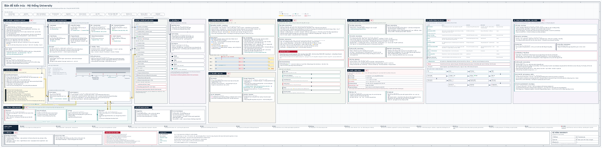

# University Copilot (UC)

| 🇻🇳 Tổng quan | 🇬🇧 Overview |
|---|---|
| Trợ lý học tập chạy **trên laptop Windows** của một sinh viên HUST: **chỉ đọc** 6 hệ thống của trường, gộp lịch / hạn / sự kiện vào Notion và nhắc đúng mốc lên máy tính và điện thoại. | A study assistant that runs **on a HUST student's Windows laptop**: it **reads** six university systems (read-only), merges schedules / deadlines / events into Notion, and sends reminders at exact times to the laptop and the phone. |
| Thành phần: web app Python (`127.0.0.1:8320`), n8n trong Docker (`:5678`), LM Studio, cổng chép lời (`:8340`), máy ghi bài giảng .NET 8 (`:5681`). | Components: a Python web app (`127.0.0.1:8320`), n8n in Docker (`:5678`), LM Studio, a speech gate (`:8340`), a .NET 8 lecture recorder (`:5681`). |
| Đây là công cụ cá nhân: một số phần (mẫu workflow n8n, cấu trúc Notion, cổng Gemini) **chưa có trong repo**. | This is a personal tool: some parts (n8n workflow templates, the Notion schema, the Gemini gate) are **not in this repo yet**. |

**Tài liệu · Docs:** [Cài đặt / Install](docs/CAI-DAT.md) · [Kiến trúc / Architecture](docs/KIEN-TRUC.md) · [Hỏi đáp / FAQ](docs/HOI-DAP.md) *(tiếng Việt)*

> **EN summary:** a personal "copilot" for a HUST student. It reads six official university systems (Outlook mail, Microsoft Teams, eHUST/qldt, iCTSV, the SoICT MOOC and FAMI) in **read-only** mode. It merges everything into one Notion workspace and pushes **time-precise reminders** to the laptop and the phone. AI (Gemini + a local LLM) extracts events from emails and classifies deadlines; n8n orchestrates the Notion side. Built by orchestrating several AIs in phases, each taking over when the previous one hit its limits (Notion AI → ChatGPT → Codex → Freebuff + Codex → Claude Code): I defined the problem, designed the architecture and rules, coordinated the agents, and tested everything on my own semester.

---

## Vấn đề

Là sinh viên Bách khoa, thông tin học tập của tôi nằm rải ở **6 hệ thống khác nhau**:

| Hệ thống | Có gì | Vấn đề |
|---|---|---|
| Outlook (mail trường) | thông báo thi, đổi lịch, sự kiện | thư đính chính chồng lên thư cũ, rất dễ sót |
| Microsoft Teams | bài tập, đổi phòng, tài liệu | phải tự vào từng nhóm lớp để đọc, rồi tải file về tay |
| eHUST (qldt) | thời khoá biểu, điểm | không chủ động nhắc |
| iCTSV | điểm rèn luyện, hoạt động ngoại khoá | tách rời khỏi lịch học |
| MOOC SoICT (daotao.ai) | bài tập có hạn và điểm | không xuất hiện ở đâu khác |
| FAMI số hoá | bài kiểm tra theo chương của các học phần MI | **không được nhắc trên Teams hay bất kỳ đâu** |

App của trường chỉ gửi một thông báo lúc 6h sáng cho cả ngày. Muốn không trễ hạn, tôi phải tự mở cả 6 nơi mỗi ngày.

## Giải pháp

UC chạy trên laptop, đọc lại các nguồn đúng khung 5 phút suốt 24 giờ (00:00, 00:05 … 23:55; máy tắt thì bỏ khung đó, không chạy bù) (**chỉ đọc**, không bao giờ gửi, xoá hay nộp bài thay tôi). Sau đó nó:

- **Gộp** lịch, hạn, sự kiện vào một workspace Notion và một giao diện web cục bộ.
- **Đọc mail bằng AI**: một sự kiện có nhiều chặng (đăng ký, thi, phúc khảo…). Thư đính chính hiển thị dạng *Trước → Nay*.
- **Nhắc đúng mốc theo mức quan trọng của hạn**, do AI phân loại:
  - *Tự luyện*: 72 / 48 / 36 / 24 giờ trước hạn.
  - *Tự luyện cốt lõi*: thêm 7h, 5h, 3h, 1h, 30', 20', 10'.
  - *Ảnh hưởng điểm môn học*: thêm 10h, 5h, 3h, 1h, 30', 20', 10', 5', 2', 1'.
  - Tiết học: 30 và 15 phút trước, đã tính cả đổi phòng lấy từ Teams.
  - **Hạn mới được báo ngay khi nó xuất hiện**, sau đó mới theo các mốc trên. Mốc rơi vào nửa đêm vẫn gửi đúng giờ.
- **Vẫn nhắc khi laptop gập máy**: các lần nhắc được hẹn sẵn trên máy chủ [ntfy](https://ntfy.sh) tới 70 giờ trước, và tự sửa hoặc huỷ khi lịch thay đổi.
- **Đồng bộ tài liệu hai chiều**: Teams ⇄ thư mục tài liệu trên máy ⇄ Notion. Tài liệu được xếp đúng môn, chống trùng bằng SHA-256.
- **Quét trùng**: phát hiện hạn hoặc lịch bị nhập hai lần. Hai mục khác mã môn thì không bao giờ bị coi là trùng.
- **Có trang riêng trên điện thoại** (Notion) và nhận lệnh xem nhanh qua ntfy.
- **Gom phần hành chính**: thông báo, giấy tờ, thủ tục, đặt vé của CTSV và thư hành chính vào tab *Hành chính*; học bổng có tab riêng. Mỗi mục có link dẫn thẳng tới trang đăng ký, thông báo đã hết hạn tự ẩn.
- **Chi tiết học phần**: bấm một môn để xem lớp thành phần, điểm thành phần và công thức tính điểm (lấy từ Teams, qldt, MOOC, FAMI).
- **Gửi tài liệu sang NotebookLM**: tìm trong kho tài liệu, tích chọn, thêm vào notebook. UC dừng ở đó; việc ôn tập không phải việc của UC.
- **Ghi bài giảng không rơi tiếng** kể cả khi máy bận. Máy yếu có thêm [add-on ưu tiên cho việc học](addons/low-end-priority/README.md).
- **Làm bài ngay từ tab Hôm nay**: bấm tên một hạn là mở thẳng chỗ làm bài (FAMI, MOOC, Teams Assignments), tự đăng nhập khi cần.
- **Học phí kỳ này** tính theo tín chỉ học phí, với luật lấy từ quyết định học phí mới nhất của trường (tự cập nhật mỗi năm), đối chiếu với hoá đơn và có nút nộp học phí.
- **Dịch tài liệu PDF sang tiếng Việt** ngay trên máy (không tốn quota), giữ bố cục và công thức; bản dịch tự vào kho tài liệu như file thả vào.
- **Chat tìm được web**: khi cần thông tin ngoài dữ liệu của trường, trợ lý chat tìm bằng SearXNG và đọc trang công khai (chỉ đọc, kết quả web chỉ là dữ liệu, không phải lệnh).
- **Ghi bài giảng và ghi cuộc họp** (Meeting-LectureRecorder): chọn Bài giảng hoặc Cuộc họp; họp thì ra biên bản gồm quyết định và việc cần làm, có phân biệt người nói.

## Add-on

| Add-on | Dành cho | Tải |
|---|---|---|
| **Ưu tiên cho việc học** (`addons/low-end-priority`) | **Chỉ máy yếu / tầm trung**: học online + ghi bài + AI chạy chung một máy. Máy mạnh / homelab thật thì **không cài** (chỉ làm UC chậm đi) | [low-end-priority.zip](addons/low-end-priority.zip) · [hướng dẫn](addons/low-end-priority/README.md) |

[](docs/Map.svg)

*Bấm vào ảnh để mở bản SVG nét đầy đủ (rộng 13.800 px, phóng to thoải mái).*

## Các quyết định thiết kế

Đây là phần tôi dành nhiều thời gian nhất:

1. **Luật tối cao: dữ liệu của trường thắng.** Mỗi khi dữ liệu trong Notion khác dữ liệu của trường:
   - *thiếu* → thêm vào;
   - *mâu thuẫn* (ví dụ hạn bị dời) → sửa theo trường, kể cả mục đã qua, và báo "Thay đổi";
   - *thừa* (việc tôi tự đặt) → giữ nguyên.
2. **Chỉ đọc nguồn của trường.** Không đổi trạng thái đã đọc của mail, không gửi hay xoá thư, không bao giờ bấm "Làm bài" trên FAMI hay MOOC.
3. **Không ghi ngầm.** Mọi thao tác ghi từ giao diện (Notion, xoá trùng…) đều phải qua bước xác nhận.
4. **Bài đã hết hạn không biến thành hạn mới.** Chúng được ghi vào lịch sử *Academic Tasks* với kết quả *Đã làm / Bỏ lỡ*, nên không nhắc vô ích.
5. **Điện thoại chỉ để xem và xác nhận đã biết.** Nút "Hoàn tất" và "Tắt nhắc" chỉ có trên máy tính, để không lỡ tay tắt một hạn thật.
6. **Kệ giờ, phải đúng mốc.** Thông báo không tự mất đi, nên mốc rơi vào nửa đêm vẫn gửi đúng giờ, đúng số ("còn 24 giờ" lúc 23:59). Không để lỡ mốc ngay từ đầu: UC cập nhật cả đêm, và hạn mới được báo ngay lúc xuất hiện rồi mới theo mốc.
7. **Mật khẩu không nằm trong code.** Tài khoản trường cất trong Windows Credential Manager. Tự đăng nhập chỉ điền trên trang đăng nhập Microsoft hoặc trang của trường, tối đa một lần mỗi lượt; gặp xác minh 2 bước hoặc captcha thì dừng và báo người dùng.

## Công nghệ

- **Python** (thư viện chuẩn + Playwright): khoảng 8.500 dòng, chia thành các module theo từng nguồn: `school_mail.py`, `teams_fetch.py`, `mooc.py`, `fami.py`, `mail_events.py`, `deadlines.py`, `alerts.py`, `phone_sched.py`…
- **n8n** (Docker): các luồng tự động phía Notion. Workflow được sinh bằng code (`build.py`), không kéo thả tay. Sơ đồ khối: [Map-n8n.svg](docs/Map-n8n.svg) ([ảnh PNG](docs/Map-n8n.png)).
- **Meeting-LectureRecorder** (`meeting-lecture-recorder/`, tên cũ `lecture-recorder/`; C# .NET 8 + NAudio): ghi giảng đường bằng micro, học online bằng âm thanh máy, hoặc riêng cuộc họp Teams qua cáp ảo VB-CABLE → n8n → chép lời trên máy (PhoWhisper, NPU) → Gemini → ghi chú bài giảng trong Notion, đồng thời xuất file .txt vào thư mục đúng môn trong kho tài liệu. Cuộc họp: thêm bước phân biệt người nói bằng pyannote (CPU) rồi viết biên bản.
- **Cổng chép lời** (`speech-gate/`, Python + OpenVINO): kiểm tra chất lượng → chép lời PhoWhisper trên NPU → nén bằng LM Studio; audio không bao giờ gửi cho Gemini.
- **Dịch PDF**: [PDFMathTranslate](https://github.com/PDFMathTranslate/PDFMathTranslate) (`pdf2zh`, AGPL-3.0, chỉ gọi như công cụ ngoài, không chép mã) chạy với model trên máy qua LM Studio. **Tìm web**: SearXNG chạy trên máy. **Phân biệt người nói**: pyannote.audio (cần token Hugging Face của người dùng).
- **Notion API**: nơi lưu dữ liệu.
- **Gemini API** (flash-lite) để đọc mail và phân loại hạn. **LM Studio** (qwen3-14b, chạy local) để xếp tài liệu.
- **ntfy**: thông báo đẩy và lời nhắc hẹn giờ lên điện thoại.
- Giao diện: một trang HTML/JS do `copilot_app.py` phục vụ tại `127.0.0.1:8320`.

## Cách tôi xây dựng dự án

UC không do một công cụ làm ra. Tôi **điều phối nhiều AI theo từng giai đoạn**. Mỗi khi một công cụ chạm giới hạn (hết quota, quên ngữ cảnh vì dự án quá lớn), tôi chuyển dự án sang công cụ tiếp theo. Bài toán, kiến trúc và luật của cả hệ thống thì tôi giữ xuyên suốt.

Từ lúc nảy ra ý tưởng (18/08/2026) đến v1.00.47 (01/11/2026) là **khoảng 11 tuần**. (Câu hỏi đầu tiên với Notion AI, "How to use notion ?" ngày 01/03, chỉ là lúc tôi mới cài Notion khi đang ôn thi TSA. Khi đó chưa có dự án hay ý tưởng nào.)

| Giai đoạn | Thời gian | Ai làm | Kết quả |
|---|---|---|---|
| **v0.0.00** | 18/08 – 23/08/2026 | **Notion AI** (chạy Claude Sonnet 5, bản miễn phí) | Ý tưởng nảy ra một tuần trước khi nhập học: "Something important for a Freshman…". Ra bản kiến trúc đầu tiên: Courses là gốc, S1–S8, Academic Work tách Academic Tasks. Tôi cho ChatGPT phản biện qua lại, rồi đánh giá bản chốt vẫn còn quá đơn giản |
| Dựng đầu tiên | 23/08 – cuối 08 | **ChatGPT** + plugin Notion | Lần đầu tôi tập nối plugin. ChatGPT đọc được workspace thật, sửa kiến trúc rồi bắt tay dựng, đến khi hết quota. Hợp với giai đoạn dự án còn nhỏ |
| Sơ đồ khởi nguyên | cuối 08/2026 | **Codex** | Bản thiết kế 10 phần, có Hội đồng 4 AI. Xem [docs/Ban-do-khoi-nguyen-Codex-2026-08.svg](docs/Ban-do-khoi-nguyen-Codex-2026-08.svg) |
| Lõi các agent | 26/08 – giữa 09 | **Codex** | Nhập TKB / deadline, University Inbox (xếp tài liệu), chia nhỏ bài lớn, lập kế hoạch ngày, ghi tiến độ, gợi ý tài liệu, hệ 6-agent đầu tiên. Dự án lớn tới mức Codex quên cả hội thoại sau nhiều lần sửa, quota đốt liên tục |
| Máy ghi bài giảng bản đầu | 09/2026 | **Codex · Freebuff** | Ghi âm và đẩy sang n8n |
| Các phase mở rộng | giữa 09 – 30/09 | **Freebuff + Codex** | Quick Upload, Health Ping, Reconciliation, Council Bridge (nối Hội đồng AI), Conductor |
| Agent theo lịch | 09/2026 | **ChatGPT** (scheduled task) | Chuyển kỳ, tìm tài liệu. Sau đó chuyển hết vào n8n |
| Tiếp quản, hợp nhất và mở rộng | từ đầu 10 | **Claude Code** | Gộp thành một workflow; đồng bộ 6 hệ thống của trường; luật tối cao; nhắc theo mốc lên điện thoại; ghi bài giảng v2 (cáp Teams, chép lời trên NPU); tab Hành chính, Học bổng, Ngoại khoá; giám sát; chat có công cụ và trí nhớ |

Phần việc của tôi xuyên suốt mọi giai đoạn:

- đặt bài toán từ chính khó khăn của mình;
- chọn công cụ, chia việc cho từng AI, đối chiếu và gộp kết quả của chúng;
- quyết định luật và kiến trúc: luật tối cao, ba mức hạn, chỉ đọc nguồn trường, điện thoại không có nút tắt, không ghi ngầm;
- phát hiện lỗi khi dùng thật và yêu cầu sửa, ví dụ:
  - AI lấy nhầm giờ nhận thư làm giờ sự kiện;
  - hai bài "vá hổng chương I" của hai môn khác nhau bị coi là trùng;
  - bài ngầm trên FAMI bị bỏ sót;
  - chat báo "đã dời hạn" trong khi không làm gì.

Từng thay đổi được kiểm thử trên học kỳ thật của tôi.

## Đóng góp

| | Vai trò |
|---|---|
| **[@RichardHenry939](https://github.com/RichardHenry939)** | Chủ dự án: bài toán, kiến trúc, luật, điều phối các AI, kiểm thử |
| **Notion AI** (Claude Sonnet 5) | v0.0.00: bản kiến trúc dữ liệu đầu tiên |
| **ChatGPT** (OpenAI) | Phản biện kiến trúc, dựng bản đầu qua plugin Notion; sau đó chạy agent theo lịch (chuyển kỳ, nghiên cứu tài liệu) |
| **Codex** (OpenAI) | Sơ đồ khởi nguyên, lõi các agent, máy ghi bài giảng bản đầu |
| **Freebuff** | Các phase mở rộng B–J, máy ghi bài giảng bản đầu |
| **Claude Code** (Anthropic) | Tiếp quản từ đầu 10: hợp nhất hệ thống, đồng bộ trường, các tab và công cụ |

**Chạy bên trong hệ thống:**
- **Gemini** (Google): đọc thư, phân loại, phân tích bài giảng đã nén;
- **Qwen3** qua **LM Studio**: nén bản chép lời, dự phòng khi hết quota, chạy local;
- **PhoWhisper** (VinAI): chép lời tiếng Việt trên NPU;
- **Hội đồng 4 AI** trong AgentChattr: Claude, Codex, Gemini và một AI local, dùng để hỏi ý kiến khi gặp vấn đề khó.

## Nhật ký bản vá

Mỗi lần cập nhật mã nguồn được tính là một bản vá (các lần chỉ sửa README hay bản đồ không tính). Mỗi bản có tag git tương ứng.

| Bản | Ngày | Nội dung |
|---|---|---|
| **v1.00.00** | 04/10/2026 | Bản công khai đầu tiên: đồng bộ 6 hệ thống của trường, luật tối cao, nhắc theo mốc lên điện thoại, đồng bộ tài liệu, quét trùng, bản đồ hệ thống |
| **v1.00.01** | 05/10/2026 | Chat trung thực: chỉ báo "đã làm" khi công cụ trả kết quả thật. Công cụ dời hạn tự đặt (xem trước rồi mới ghi, không đụng hạn của trường). Ghi bài giảng riêng cuộc họp Teams qua cáp ảo |
| **v1.00.02** | 05/10/2026 | Thêm mã nguồn máy ghi bài giảng (`lecture-recorder/`, nay là `meeting-lecture-recorder/`) |
| **v1.00.03** | 05/10/2026 | Phân loại thư (môn học, ngoại khoá, hành chính, học bổng, thông báo chung). Tab Hành chính và Học bổng. Đọc đủ 1000 sự kiện CTSV. Giám sát Ghi bài giảng ngay trong UC. Chat nhớ hội thoại. Mọi nguồn cập nhật 5 phút một lần |
| **v1.00.04** | 05/10/2026 | Thêm cổng chép lời (`speech-gate/`), kèm vá: tự thử lại khi LM Studio lỗi, model dự phòng, chạy tiếp từ bước nén |
| **v1.00.05** | 06/10/2026 | Tự ẩn thông báo hết hạn hoặc của năm cũ. Chi tiết điểm học phần. Gửi tài liệu sang NotebookLM. Script giữ phiên NotebookLM. Đọc cả kênh ẩn và Shared Documents trên Teams. Lượt đồng bộ lỗi không còn ghi đè dữ liệu tốt |
| **v1.00.06** | 06/10/2026 | Cách tính điểm cho mọi môn, tự động mọi kỳ: đọc thêm trả lời trong luồng ở mọi kênh, Class Notebook và nội dung mọi slide / đề cương (trước chỉ đọc file có tên "đánh giá", nên sót IT1108 có công thức nằm trong slide chương 1). Ưu tiên bài nói rõ nhất về cách tính, bỏ qua trả lời của sinh viên |
| **v1.00.07** | 06/10/2026 | Sửa lỗi điểm cuối kỳ "ma": thành phần "Cuối kỳ trên MOOC tại phòng máy" (IT2000) bị gán nhầm điểm bài tập MOOC hằng tuần. Cuối kỳ giờ được nhận diện trước, và chỉ lấy điểm khi qldt có nhãn CK rõ ràng |
| **v1.00.08** | 06/10/2026 | Nhắc đúng mốc, không gửi bù: trước đây hạn mới phát hiện sau mốc 48 giờ hoặc mốc rơi vào đêm bị nhắc bù với số giờ lẻ ("còn 38 giờ", "còn 41 giờ"). Giờ chỉ nhắc đúng các mốc; mốc rơi vào 23:00–06:00 vẫn tới đúng giờ nhưng không chuông, không rung |
| **v1.00.09** | 06/10/2026 | Luật mới "kệ giờ, phải đúng mốc": bỏ hẳn giờ yên lặng cho các mốc nhắc (thông báo không tự mất đi), mốc đêm có chuông như ban ngày. Nhắc tiết học cũng chỉ đúng 30 và 15 phút |
| **v1.00.10** | 06/10/2026 | Cập nhật đúng khung 5 phút suốt 24 giờ (trước chỉ 06:00–23:30, khiến hạn xuất hiện ban đêm bị phát hiện muộn và lỡ mốc); máy tắt thì bỏ khung, không chạy bù. Hạn mới được báo ngay lúc xuất hiện, sau đó mới theo các mốc |
| **v1.00.11** | 06/10/2026 | Ghi chú bài giảng không còn chỉ nằm trên Notion: mỗi ghi chú được xuất thành file .txt vào đúng thư mục môn đã gán trong Uni-Documents (`<môn>/Ghi chú Bài giảng/`), tự cập nhật khi ghi chú trên Notion được sửa. File UC xuất không bị nạp ngược lên Notion / Drive |
| **v1.00.12** | 06/10/2026 | Cổng gỡ tài liệu nhận thêm dòng 📥 University Inbox (vẫn chỉ chuyển vào thùng rác, có kiểm tra bảng), để dọn được file bị nạp nhầm |
| **v1.00.13** | 06/10/2026 | Mục **Học phí kỳ này** (tab Hành chính): giá đơn vị / tín chỉ, số tín chỉ của kỳ đang học, tổng học phí tự nhân rồi đối chiếu với hoá đơn trên trang học phí của trường, kèm nút "Nộp học phí tại đây". Sửa đồng bộ qldt: nút đăng nhập mới của trường và popup khảo sát che trang (chỉ ẩn trên máy, không trả lời khảo sát) |
| **v1.00.14** | 07/10/2026 | Giữ phiên NotebookLM: khi Google còn phiên, cửa sổ đăng nhập tự lưu rồi đóng mà không báo động nhầm; chỉ khi sau 90 giây vẫn cần đăng nhập tay mới hiện thông báo. Lượt đăng nhập im lặng được 120 giây thay vì 45 |
| **v1.00.15** | 09/10/2026 | Dịch tài liệu PDF sang tiếng Việt trên máy (tab Inbox, bản dịch tự vào kho). Chat tìm web qua SearXNG, hết quota Gemini thì dùng model chạy trên máy. Chế độ Họp: chọn Bài giảng / Cuộc họp, biên bản có quyết định và việc cần làm, phân biệt người nói; máy ghi đổi tên Meeting-LectureRecorder. Sửa giữ phiên NotebookLM: chỉ một cửa sổ đăng nhập mỗi lúc, có công tắc tạm dừng. Cập nhật bản đồ |
| **v1.00.16** | 11/10/2026 | Học phí tính đúng theo **tín chỉ học phí**: mỗi năm UC tự tìm *Quyết định mức học phí* mới trên trang công khai của trường, đọc đơn giá và bảng quy đổi, lấy khối lượng lý thuyết / bài tập / thí nghiệm từng môn để tính; môn chưa tính chắc thì ghi "chưa rõ" và đối chiếu với hoá đơn. Phân biệt người nói trong chế độ Họp: sửa lỗi làm bước này bị bỏ qua |
| **v1.00.17** | 12/10/2026 | Nút **Làm bài** ở tab Hôm nay: bấm một hạn là mở thẳng chỗ làm bài (phòng kiểm tra FAMI, đúng bài MOOC, bài tập Teams Assignments) trong một cửa sổ Chrome riêng, tự đăng nhập tài khoản trường khi cần, cửa sổ ở lại cho bạn làm; UC không bấm nộp thay bạn |
| **v1.00.18** | 12/10/2026 | **Luật tối cao cho tiếng ghi bài giảng**: sửa lỗi máy ghi đánh rơi tới ~một nửa tiếng Teams khi máy bận (máy ghi tự ưu tiên cao, đọc cáp ảo theo sự kiện với bộ đệm lớn hơn; thử ép tải CPU: từ 28 lỗ rơi xuống 0). Trong lúc ghi, mọi việc AI (chép lời, nén, model chạy trên máy) tự nhường; ba nhóm học / AI / homelab chỉnh được bằng file cấu hình để máy vẫn học được khi chạy dịch vụ tại nhà. Bản ghi thử không còn hiện lên bảng giám sát |
| **v1.00.19** | 12/10/2026 | Tách luật nhường ưu tiên thành **add-on cho máy yếu** (file .zip kèm hướng dẫn riêng): 4 bậc học > web học tập > homelab > AI, và việc AI chờ khi đang ghi bài. Không cài add-on thì UC chạy hết sức như trên máy mạnh. Bản sửa lỗi máy ghi vẫn nằm trong phần lõi |
| **v1.00.20** | 12/10/2026 | **Sửa học phí tính sai nghiêm trọng**: UC đọc thẳng trang học phí thật của trường (ctt-sis, "Thông tin học phí"): số tín chỉ học phí và tiền từng môn, công nợ (đã nộp, bảo hiểm y tế, phí khám sức khoẻ), **số còn phải đóng** và hạn đóng; số của trường là chuẩn, phần UC tự tính chỉ để đối chiếu từng môn. Sửa quy tắc tự tính cho Giáo dục quốc phòng và Giáo dục thể chất (trước đó ghi "chưa rõ"); nút tra / nộp học phí trỏ đúng trang của trường |
| **v1.00.21** | 12/10/2026 | Sửa luồng phân tích bài giảng bị kẹt: bước cứu hộ phiên treo bị lỗi làm cả luồng dừng; khi Gemini trả kết quả không đọc được thì trước đây bị ghi nhầm "không phải bài giảng", nay ghi đúng lý do và tự chạy lại (tối đa 3 lần); tải audio từ Drive lỗi thì tự mở khoá phiên thay vì treo 6 giờ |
| **v1.00.22** | 14/10/2026 | Add-on "máy yếu": AI chỉ xuống ưu tiên thấp nhất khi đang ghi bài (và 2 phút sau), lúc khác dưới bình thường — chép lời không còn bị đói CPU; thêm gợi ý giới hạn RAM Docker/WSL. Add-on mới **network-guard** (`addons/network-guard.zip`): mất mạng 3 phút thì tạm dừng đồng bộ và đóng băng n8n, có mạng lại thì chạy tiếp và tự bật lại dịch vụ UC đã tắt |
| **v1.00.23** | 14/10/2026 | Gộp PR #1 và #2: gỡ ID n8n và đường dẫn máy cá nhân khỏi mã nguồn (cấu hình qua `config.json` / biến môi trường), bộ 264 test tự động + CI; sửa 4 lỗi thật — thông báo kiểu "CPA từ 3.2" bị ẩn nhầm, điểm B+/C+/D+ bị hạ thành B/C/D, giờ khoá MOOC lệch 7 tiếng, trang web lạ có thể ra lệnh cho UC (CSRF) |
| **v1.00.24** | 14/10/2026 | Tab Lịch có **kế hoạch tự học** (giờ tự học theo khối lượng của trường, ví dụ 4(3-0-2-8) = 8 giờ/tuần, chia đều vào giờ trống, tránh ngày nghỉ và hoạt động bạn đã chọn "Sẽ đi") và **xuất Google Calendar (.ics) / Excel**. Sửa 5 lỗi từ đợt đánh giá: cổng chép lời không còn gửi khoá tới địa chỉ lạ; file trạng thái ghi an toàn khi tắt máy đột ngột; TKB / CTĐT đổi định dạng không còn xoá nhầm buổi học hay ghi 0 tín; năm nhập học đặt được (`UC_INTAKE_YEAR`) cho mọi khoá |
| **v1.00.25** | 14/10/2026 | Kế hoạch tự học tránh cả **giờ thực tập hè**: đọc cột Work Hours của ☀️ Kỳ hè (vd "T2-T6 8:00-17:00", "T2,T4 13h-17h"), áp đúng khoảng hè đó, ca thực tập có trong file Google Calendar; giờ ghi không đọc được thì báo rõ |
| **v1.00.26** | 14/10/2026 | Tab Học kỳ có thêm **kỳ hè 2026.3 / 2027.3 / 2028.3** xen giữa các năm (như kỳ hè của trường: không hiện CTĐT, không hiện trạng thái; tới hè mới hỏi học hè / nghỉ / thực tập). Kế hoạch tự học tránh cả **giờ làm thêm trong năm** (school/part_time.json, dùng chung bộ đọc giờ với thực tập hè) |
| **v1.00.27** | 14/10/2026 | Sửa lỗi dữ liệu: bấm "Sẽ đi / Bỏ" hoặc "Tắt nhắc" đúng lúc UC đang đọc thư không còn bị mất; một kết quả AI lạ không còn làm tắc vĩnh viễn việc đọc thư (thư lỗi 3 lần được bỏ qua, ghi lý do); MOOC / FAMI / iCTSV / Teams trả rỗng không còn xoá dữ liệu cũ; FAMI không còn đánh "đã nộp" bài chưa làm; bài MOOC "Đã làm" không còn bị hạ thành "Bỏ lỡ" |
| **v1.00.28** | 14/10/2026 | **Phòng họp 4 ghế AI (AgentChattr) vào repo** (`agentchattr/`: bản vá trên agentchattr MIT + bộ giữ ghế, relay hội đồng). Bền hơn: bộ giữ ghế không còn chết im lặng; phòng chat treo được tự phát hiện và bật lại (thử: hồi phục sau 105 s); network-guard giữ bộ giữ ghế luôn chạy; đọc lại được trạng thái "hết quota / cần đăng nhập" của từng ghế |
| **v1.00.29** | 14/10/2026 | **Luật mới: TKB không thắng thông báo đính chính trên Teams/mail** (`class_override.py`): lớp báo nghỉ / chuyển online / đổi phòng / đổi giờ → dòng TKB trên Lịch đổi theo, bản gốc giữ trong ghi chú. **Chat đọc được hoạt động ngoại khoá**: ngữ cảnh thêm bảng 🎯 (đã đăng ký, đang diễn ra, sắp hết hạn đăng ký, sự kiện trường) — trước đó chat nói "hôm nay không có hoạt động ngoại khoá" dù đang có. 285 test |
| **v1.00.30** | 15/10/2026 | **Recorder nghe được qua CABLE Input ngay cả khi không ghi** (bộ nghe cáp thường trực, tách khỏi luồng ghi: Teams chọn loa CABLE Input là nghe được). Sửa tên môn bị rỗng trong ghi chú bài giảng xuất ra (đọc đúng cột tiêu đề Name của Courses). 297 test |
| **v1.00.31** | 19/10/2026 | **Deadline gọn hơn:** bấm thông báo ntfy mở thẳng chỗ làm bài (FAMI / MOOC / Teams; không rõ thì trang Notion). Tab Hôm nay tách 3 mục: Hạn môn học · Hạn tự luyện · Hạn đã qua (thu gọn). **Hạn tự luyện quá hạn tự gia hạn +1 tuần**, đếm số lần, cảnh báo từ lần 3, và không nhắc ra ngoài nữa; hạn của trường không bao giờ bị dời. 300 test |
| **v1.00.32** | 24/10/2026 | **Lịch thi giữa kỳ hiện trên đầu tab Hôm nay** (đọc từ FAMI, trang Lịch thi). Hạn của môn có thi giữa kỳ được đánh dấu đỏ. 305 test |
| **v1.00.33** | 24/10/2026 | **Connector MCP cho UC** (uc_mcp/): Claude đọc được tổng quan UC (lịch thi, hạn, việc hôm nay) từ mọi nơi khi máy bật; khi máy tắt chuyển sang Notion và báo máy đang tắt. Chỉ đọc. Kèm 2 skill (uc-briefing, uc-assistant). 314 test |
| **v1.00.34** | 24/10/2026 | **Thi giữa kỳ từng môn**: mỗi môn đang học một dòng (lịch FAMI / thông báo Teams-mail / có thi chưa lịch / chưa có tin / không thi), hạn của mọi môn sẽ thi được tô đỏ. **Connector trên Firebase** (uc_mcp/cloud): máy chỉ gửi đi bản tóm tắt, Claude gọi qua đường dẫn bí mật, máy tắt thì báo máy tắt kèm bản cuối; chặn máy tìm kiếm. 323 test |
| **v1.00.35** | 25/10/2026 | **Lịch thi là một loại hạn đặc biệt**: mục "Lịch thi" đầu tab Hôm nay (thẻ đỏ đặc, ngày, kíp, phòng, còn bao lâu), môn chưa có lịch / không thi chỉ còn 1 dòng ghi chú. **Lịch thi hiện trên tab Lịch** (tuần và tháng). Viền đỏ chỉ cho hạn của môn đã có lịch thi. 324 test |
| **v1.00.36** | 26/10/2026 | **File Zalo vào kho tài liệu**: file tải từ Zalo vào thư mục riêng (`paths.zalo_inbox`, mặc định `Downloads\Zalo-Logistic-Checkpoint`) được chép vào Inbox, kiểm SHA rồi mới xoá bản gốc (máy chỉ giữ 1 bản), agent xếp vào Uni-Documents, sao lưu Drive và lên University Inbox (Notion). Trùng nội dung thì chỉ xoá bản Zalo. Tin nhắn Zalo bị mã hoá nên không đọc. 330 test |
| **v1.00.37** | 26/10/2026 | **Inbox**: nút "Mở trong thư mục" (File Explorer, chỉ file trong Uni-Documents). **Ngoại khoá**: tắt nhắc từ điện thoại (từng mục, hoặc cả loại bằng "tắt / bật ngoại khoá"), luôn hỏi Xác nhận rồi huỷ tin đã hẹn; hạn minh chứng chỉ nhắc 2 lần (24 giờ, 3 giờ) và có nút "Đã nộp MC"; vòng 2 / bán kết / chung kết chỉ nhắc khi bạn bấm Sẽ đi. **Học kỳ**: vắng ở môn nào, ngày nào. 333 test |
| **v1.00.38** | 26/10/2026 | **Giao diện**: lịch tuần dạng lưới giờ (mỗi buổi đặt đúng giờ, cao theo thời lượng, chồng giờ chia làn, hạn nộp là mốc đỏ đúng giờ, vạch "bây giờ", lịch thi khối đỏ); thanh điều hướng dọc trên màn hình rộng. 333 test |
| **v1.00.39** | 26/10/2026 | **Giao diện**: tab Lịch đổi tên **Thời khoá biểu toàn kỳ**, đứng đầu và mở mặc định; tab **Hôm nay** được gộp vào cuối tab này (bấm một ngày ở lịch thì phía dưới hiện việc hôm nay, chế độ ngày, lịch thi và hạn nộp); **Trò chuyện** đổi tên **Chatbot hỗ trợ**, xếp thứ 2. **Vá lỗi**: chatbot từng xếp hoạt động ngoại khoá *chưa đăng ký* (đang mở đăng ký / sự kiện trường) vào "lịch của bạn" theo ngày; nay ngữ cảnh ghi rõ các mục đó không phải lịch của bạn, và prompt thêm luật lịch: chỉ buổi học, lịch thi, hạn nộp và hoạt động đã đăng ký mới vào lịch, phần còn lại để riêng ở mục "Có thể đăng ký". |
| **v1.00.40** | 31/10/2026 | **Nguồn dữ liệu sát thực tế hơn**: MOOC đọc hạn qua API (giữ dữ liệu cũ khi API lỗi, không coi điểm > 0 là bằng chứng đã nộp); lịch thi đọc từ PDF bảng (`exam_pdf.py`, chỉ lấy hàng đúng lớp, gộp với FAMI); Zalo chỉ nhận file đã tải về thư mục checkpoint, không tự đọc tin nhắn; connector có thêm ngoại khoá và Inbox. Kèm bản vá 26/10: chatbot không xếp ngoại khoá chưa đăng ký vào lịch. Phát hành lên GitHub ngày 31/10 cùng v1.00.41 |
| **v1.00.41** | 31/10/2026 | **Nguồn dữ liệu sát thực tế**: đọc deadline MOOC qua API; lịch thi từ PDF đúng lớp; **lịch đè từ Teams** (đổi buổi/phòng/giờ trong Teams thắng eHUST và qldt); **đọc cả phần trả lời trong luồng Teams** (đính chính của giảng viên); Zalo nhận file trong thư mục checkpoint; connector có thêm ngoại khoá và danh sách Inbox. 352 test |
| **v1.00.42** | 01/11/2026 | **Giao diện mới** ("mực tím + tờ lịch xé"): điều hướng dọc có icon, cột Hôm nay, thanh GDTC/Hè/Học lại thành ngăn kéo. **Tab Ví thời gian** đứng đầu: phiên tập trung 25 + 5 (mỗi khối 25 phút trọn +5 phút ví, hoàn tất hạn +15 phút, giải trí trừ theo phút thật), brown noise hoặc Claude Radio, thống kê ngày/tuần/tháng; việc hôm nay, Camp/Rest, hạn môn học, lịch ôn tập và Gợi ý gộp vào đây. **Thời khoá biểu**: lịch thi trên cùng, mục Ngày cạnh lịch tuần, mọi loại hạn hiện trên lịch, lưới giờ tới 24:00. **MSSV** lưu mã hoá DPAPI (tab Giới thiệu), đối chiếu danh sách học offline của lớp để ghi "trực tiếp / online" lên đúng buổi. MOOC: báo bài chưa có hạn kỳ này. Thi giữa kỳ: bỏ tin của sinh viên trong team lớp. Connector thêm lịch, cảnh báo, chứng chỉ, MOOC. 370 test |
| **v1.00.43** | 01/11/2026 | **Vá CI**: bộ test chạy xanh trên cả Ubuntu (trước đó một test Zalo so đường dẫn kiểu Windows nên hỏng trên Linux từ v1.00.41). **Ví thời gian**: tín hiệu "đang tập trung đến giờ X" (cho công cụ chặn trang chạy riêng trên máy, tuỳ chọn) lùi giờ hết hạn khi tiếp tục sau tạm dừng. 370 test |
| **v1.00.44** | 01/11/2026 | **Ví thời gian chặt hơn**: bắt đầu phiên tập trung phải nhập lại MSSV (máy chủ so với số đã lưu, không trả số về) để tránh bấm nhầm; đã bắt đầu thì không huỷ được, phiên tự kết thúc khi hết giờ (tạm dừng không gỡ chặn). **Thúc đi học**: còn việc hôm nay mà phút tập trung chưa đạt tổng giờ dự kiến thì nhắc bằng thông báo (máy + điện thoại), tối đa 1 lần/giờ, 08:00–21:30, không nhắc khi đang học, đang tập trung hay ngày Rest; nhắc không khoá gì. **Lịch thi** hiện cả ở tab Ví thời gian. **Vá**: âm nền tắt hẳn khi phiên kết thúc và đồng bộ giữa nhiều tab UC; test ví không còn ghi vào tệp tín hiệu thật. 376 test |
| **v1.00.45** | 01/11/2026 | **Ngoại khoá kiểu CTSV**: thanh điểm rèn luyện (đọc tổng SV tự chấm trên CTSV) + nút Chấm lại (UC chấm thử, chỉ lưu lên CTSV khi bạn bấm Xác nhận); mục con "Sự kiện & hoạt động" dạng thẻ có ảnh bìa CTSV (ảnh tải về máy, phục vụ qua `/ctsv-img/<mã>`), nhóm Sắp diễn ra / Đang diễn ra, ẩn mục hết hạn; mục con "Hoạt động của tôi" (4 ô số liệu, hạn nộp minh chứng nổi bật, chờ xác nhận lên trên). **Thời khoá biểu toàn kỳ** hiện hạn nộp minh chứng, hạn đăng ký và hoạt động đã đăng ký (màu hổ phách). Mục con **Học bổng** (thẻ: số tiền, hạn, số suất, Đang mở / Hết hạn — mặc định ẩn hết hạn, xem chi tiết) và **Hành chính & đặt vé** (vé của bạn, sự kiện đang mở đặt vé, giấy tờ đã xin, thủ tục có thể xin; UC chỉ hiện và dẫn link CTSV, không tự đặt vé hay gửi đơn). "Hoạt động của tôi": mục đăng ký qua mail / Teams đứng riêng, không đếm vào "Chờ xác nhận"; hoạt động CTSV đã qua hơn 2 tuần mà chưa xác nhận gom vào nhóm thu gọn. **Trang chủ** (bấm logo; trên điện thoại có nút Trang chủ): ảnh nền + chữ lớn — đặt ảnh của bạn vào `ui/assets/hero.jpg` (hoặc .png / .webp; tệp này không đưa lên git), chưa có thì dùng nền màu; hạn môn học dạng thẻ, hạn đã qua gom vào nhóm thu gọn. 383 test |
| **v1.00.46** | 01/11/2026 | **Tab 10000 bước chạy**: câu chốt "Phù hợp để ra ngoài: X%", thời tiết và không khí quanh trường (Open-Meteo), bảng xếp hạng top 100 như trang CTSV (không giữ mã sinh viên của ai); nhập tổng bước cả ngày theo app vì CTSV web chỉ có quãng đường giải tính. Mục tiêu đi bộ nằm trong tờ lịch ngày ở Thời khoá biểu, ngày thi thì lịch thi lên trên. Thư mục "Hành chính" xếp như một môn ở máy nhưng gửi Notion không gắn môn. 408 test |
| **v1.00.47** | 01/11/2026 | **Đổi giấy phép sang PolyForm Noncommercial 1.0.0**: dùng cá nhân, học tập, nghiên cứu, tổ chức phi lợi nhuận thì tự do; dùng thương mại phải xin phép tác giả. Các bản đến v1.00.46 đã phát hành theo MIT vẫn giữ MIT. Thư mục `agentchattr/` (mã của Ben Curtis) giữ giấy phép MIT gốc, có file `agentchattr/LICENSE` |
| **v1.00.48** | 02/11/2026 | **Một font cho cả hệ thống** (Bricolage Grotesque, kể cả khung chat); tiêu đề UC nhỏ lại còn một nửa, dòng tên trường rộng đúng gấp đôi dòng UC (ảnh chữ của trường chỉ đặt trên máy, không có trong repo). **Connector**: `uc_inbox` có thêm link Google Drive và đường dẫn trên máy của từng file; skill mới **UC_NotebookLM** (`uc_mcp/skills/uc-notebooklm`) hướng dẫn Claude đưa đúng file vào NotebookLM. `push.py` phân biệt "UC tắt" với "UC lỗi" (thoát mã khác 0 để Task Scheduler báo lỗi thật, ghi `push_status.json`). File chuyển sang thư mục khác thì đổi luôn môn theo thư mục mới. README: sửa mục v1.00.40 lỗi thời, thêm dòng v1.00.40, ghi rõ tên và logo UC không được cấp quyền theo giấy phép |
| **v1.00.49** | 02/11/2026 | **Thông báo từng việc một**: mỗi hạn / ngoại khoá / sự kiện là một tin riêng, tiêu đề ghi tên việc và giờ hạn; việc rơi vào giờ ngủ (22:00–06:00) được nhắc thêm lúc 08:00 / 14:00 / 20:00 / 21:30 hôm trước; tin gộp "còn việc hôm nay" chỉ hiện trên máy, không lên điện thoại. **Lịch thi**: quét được lịch thi là báo động ngay (trừ thể dục thể thao và quốc phòng an ninh), lịch thi đứng trên cùng, mỗi ngày tới ngày thi có việc "Ôn thi định kỳ hằng ngày môn X" không tắt được; "Hạn sắp tới" đổi thành **"Việc cần làm hôm nay"** (hiện mọi việc hôm nay, ít thì bù hạn gần nhất cho đủ 6). **Hình nền động** `/widget` (dùng với Lively Wallpaper): đồng hồ 24 giờ, lịch thi, lịch hôm nay, việc cần làm, tự đổi bố cục theo số màn hình; đang tập trung mà chỉ có màn laptop thì ẩn icon màn hình nền. Đồng hồ 24 giờ tô màu theo việc đã làm (lãng phí / học / tập trung / giờ ngủ). **Máy ảo Android**: tự đăng nhập lại iCTSV khi hết phiên (tài khoản cất trong Credential Manager, bị từ chối 1 lần thì khoá), đọc số bước thật từng lượt từ app iCTSV, đối chiếu lịch tuần trên app eHUST với lịch UC (Teams đứng trước eHUST) |
| **v1.00.50** | 02/11/2026 | **Khoá giờ ngủ** (đêm 22:00–06:00 + ngủ trưa theo phần vàng UC tô) thành một phần của UC, bản công khai ở `locks/` với tên chung: chặn mạng xã hội + game, chừa Messenger; mất tín hiệu thì không khoá trưa |
| **v1.00.51** | 02/11/2026 | **Drive ngăn nắp như máy**: sửa lỗi n8n đổ mọi file vào một thư mục với tên ép phẳng; giờ cây `Uni-Documents/<thư mục như trên máy>/<tên thật>`, chuyển file trên máy thì chuyển theo trên Drive (giữ fileId, link NotebookLM không gãy); không bao giờ ghi qua ổ Drive for desktop |
| **v1.00.52** | 02/11/2026 | **Bản chép lời Teams thay recorder** cho lớp lý thuyết học online: tải transcript .vtt của bản ghi họp (chỉ đọc) -> nén trên máy -> ghi chú bài giảng như recorder, giữ .vtt gốc cạnh file .txt; Teams chép nhầm ngôn ngữ (vd en-US) thì bỏ; môn còn lịch thi nén ngay, môn chưa có lịch thi dồn sang đêm. Cổng chép lời có `POST /jobs/text` (chữ có sẵn, chỉ nén). **Fitness** (tab mới, gộp 10000 bước): số đo cơ thể (chỉ ở máy) + **bài tập tại chỗ do Gemini lập** — thảm, sàn, ghế, ≤ 20 phút, tránh DOMS, mục tiêu tăng cơ, gọi đúng tên bài kèm nút tìm YouTube; connector có `uc_fitness`. **Đi bộ**: đọc app iCTSV ngay sau khung đỏ, bảng ngày hiện số bước / km thật của app (số ước tính đánh dấu ~), lượt đọc ra 0 khi phiên hết hạn không còn ghi đè số cũ. **Drive**: tải bù file chưa có bản Drive (`drive_backfill.py`, cổng n8n `copilot-drive-upload`, hướng dẫn ở `docs/N8N-DRIVE.md`). **Khoá ngủ trưa** tự tải lại tab mạng xã hội đang mở. Skill UC_NotebookLM ghi cấu trúc Drive, thiếu link thì báo "chưa sao lưu" |
| **v1.00.53** | 03/11/2026 | Bốn phần, mỗi phần một commit. **(1) Gỡ id thư mục Drive** khỏi `build.py`: đọc từ biến môi trường `UC_DRIVE_BACKUP_FOLDER`, mã công khai không còn id thật. **(2–3) Chế độ tập trung chừa đường đăng nhập Meta** để dùng được Muse (trợ lý AI của Meta): facebook.com và instagram.com vẫn bị chặn, trừ các đường đăng nhập (login, checkpoint, oauth, Accounts Center...); tab bảng tin đang mở tự tải lại để ăn chặn; khoá đêm và ngủ trưa không đổi. **(4) Khoá tiến vào máy ảo Android** (`phone_lock.py`): trong giờ khoá đêm / ngủ trưa / tập trung, UC tạm khoá app mạng xã hội, trình duyệt, app Google bằng adb (`cmd package suspend`; Play Store thì tắt), hết giờ mở lại đúng app nó đã khoá; không đụng Messenger / iCTSV / eHUST; tập trung chừa YouTube. Kèm luật tạm dừng: bấm dừng không gỡ chặn (tín hiệu gia hạn mỗi phút); khung thể dục = dừng bắt buộc, gỡ hết chặn; phiên giải trí gặp khung thể dục thì kết thúc, chỉ trừ phút đã dùng (luật dừng chỉnh lại ở v1.00.54) |
| **v1.00.54** | 03/11/2026 | **Hai kiểu tạm dừng tập trung**: UC tự dừng (giờ học / giờ ngủ / khung thể dục, giao diện hiện nút "Tiếp tục") thì **gỡ chặn ngay**, cả trên máy lẫn trong máy ảo; bạn tự bấm dừng (nút ▶) thì **chặn giữ nguyên** tới khi bạn tiếp tục. UC dừng đè lên lúc bạn đang tự dừng (vd tới khung thể dục) thì chuyển thành UC dừng. Giao diện không tự gọi dừng ở khung đi bộ nữa (trước đây bị tính nhầm là bạn bấm) |
| **v1.00.55** | 03/11/2026 | **Thông báo dễ chịu hơn**: lời thúc đi học tách mỗi việc chưa xong một tin riêng (tên việc, giờ dự kiến, còn bao lâu tới 22:00), phút tập trung một tin riêng; âm thông báo đổi từ kiểu chuông sang âm mặc định nhẹ hơn (chuông quá to trong tai nghe). **Đọc giờ trong thư đúng buổi**: "tối mai ... 8h30" là 20:30, không phải 08:30 (Gemini hay đọc nhầm; UC soát chữ sáng / trưa / chiều / tối / đêm quanh giờ đó). **Đi bộ trên lịch ngày**: khung đi bộ hiện đỏ trong "Lịch trong ngày"; khung đã qua vẫn giữ màu đỏ trên đồng hồ thay vì thành xám. **Hình nền gọn hơn**: dải tóm tắt hôm nay (phút tập trung tô màu theo mức: 0 phút đỏ, >0 vàng, >30 xanh biển, >60 xanh lá, >120 xanh ngọc; số dư ví; còn bao nhiêu việc hoặc "đã hết việc"; Fitness số bước / mục tiêu), khung chữ khoá trong ô được cấp, thừa thì mờ dần thay vì đè icon; nhãn "UC đang tắt" nằm ngay dưới đồng hồ. **Đủ bước thì tắt đỏ ngay** (trước giữ tới hết khung). Ngăn kéo GDTC / Hè / Học lại không còn bị thanh trên che nút đóng, bấm Esc để đóng |
| **v1.00.56** | 03/11/2026 | **Đọc số bước không còn mù khi máy ảo chết**: máy ảo Android tắt quá 2 phút trong 06–22h thì UC báo và tự bật lại (cách nhau ≥ 10 phút, tối đa 3 lần/ngày; tắt bằng file `school/android_autostart.off`), chạy lại thì đọc app ngay. Lệnh adb có hạn chờ 60 s (adb kẹt từng làm cả vòng canh đứng im). Mỗi lượt đọc ghi vào `school/ictsv_probe.log`. **Khung đi bộ chỉ dời khi UC đã đọc được app sau khung** mà vẫn thấy chưa đi; chưa đọc được thì giữ nguyên khung (trước đây 0 bước giả làm khung trượt mãi dù bạn đã đi). **Cập nhật nhanh trong khung đỏ**: từ lúc khung đi bộ bắt đầu tới khi đã đọc được app sau khung, UC đọc mỗi 3 phút (ngoài khung vẫn mỗi giờ), đi đủ là đỏ tắt ngay |
| **v1.00.57** | 03/11/2026 | **Sửa tab Fitness trong bản công khai**: bản v1.00.52 sót các đường `/api/fitness` (xem, lưu số đo, lập bài, đánh dấu đã tập) trong `copilot_app.py` nên tab Fitness không chạy; nay đã có, kèm test |
| **v1.00.58** | 03/11/2026 | **Gỡ đường đăng nhập Meta trong chế độ tập trung** (thêm ở v1.00.53 cho Muse): Muse chưa phát hành ở Việt Nam nên không dùng được; khi tập trung, facebook.com và instagram.com lại bị chặn hẳn. Danh sách đường đăng nhập cũ chỉ còn dùng để dọn mục cho phép sót lại trong chính sách Chrome/Edge |
| **v1.00.59** | 04/11/2026 | **Chỉ một bản UC chạy** (`single_instance.py`, mutex có tên của Windows): 03/11 có hai bản chạy song song khiến khoá máy ảo, iCTSV, thông báo chạy đôi; bản sau giờ chờ tối đa 90 giây cho bản trước tắt hẳn rồi tự thoát. **Khoá máy ảo có nhật ký** (`school/phone_lock.log`: mỗi lần khoá / mở / đổi chế độ). **Máy ảo tự bật lại thì chạy ẩn** (UC gọi script mở máy ảo kèm `-Hidden`; script đó phải nhận tham số này và chạy emulator với `-no-window`) |
| **v1.00.60** | 04/11/2026 | **App UC trên Android** (`android/`, dựng không cần Gradle bằng `build.ps1`): mở chính UC web của laptop qua Tailscale (cổng riêng `RemoteH`, khoá cookie riêng cho điện thoại), giao diện điện thoại có thanh điều hướng dưới, trang chủ mở trước. **Widget 4x2**: đồng hồ 24 giờ cùng luật màu hình nền desktop (kim phút + giây chạy thật), giờ có giây, dải tóm tắt, 3 việc, buổi tới; dữ liệu lấy từ bản tóm tắt connector (đường chỉ đọc). **Bản đồ khuôn viên** (Thời khoá biểu + Lịch và thời gian): dữ liệu OpenStreetMap (ODbL, `build_campus_map.py`), chỉ toà Bách khoa (theo ranh giới khuôn viên trên OSM) được sơn khối màu, cắm ghim buổi học hôm nay. **PhoneLock** 4 mức (Default / Focus / Nap / Night) bám theo khoá tương ứng của laptop; trong giờ khoá điện thoại đi qua laptop (exit node) để ăn chặn tên miền. **Ví**: phiên sang ngày mới tự chốt tại 00:00. Font Bricolage Grotesque (SIL OFL 1.1, `android/FONT-OFL.txt`). |
| **v1.00.61** | 04/11/2026 | **PhoneDefaultLock chặn web MXH trên điện thoại** mà laptop vẫn vào được: `phone_dns.py` là máy chủ DNS nhỏ trên địa chỉ Tailscale của laptop; split DNS của Tailscale giao riêng các tên miền MXH cho nó (đặt một lần bằng `phone_dns_tailscale.py`, key tự nhập lúc chạy; mở cổng bằng `phone_dns_firewall.ps1`). Chặn bản web Facebook (chừa tên miền app Messenger dùng), Instagram, Threads, TikTok, X, Reddit, Discord... và web YouTube; laptop không nhận DNS của Tailscale nên không bị chặn. Laptop tắt thì các tên miền này không phân giải được (đóng mặc định). App YouTube gốc (có Shorts) khoá ở Default, xem bằng ReVanced; app UC Android giao link ngoài cho Android, link YouTube mở thẳng ReVanced. |
| **v1.00.62** | 05/11/2026 | **Tập trung trong giờ học**: bật tập trung khi đang có buổi học / ngoại khoá không còn tự dừng; đồng hồ 24 giờ tô phần đó màu xanh nõn chuối (vừa trong lịch, vừa khoá máy như tập trung). **Thông báo đứng tên University Copilot** trên máy tính (thay "Windows PowerShell"; bấm thông báo hạn nộp mở thẳng chỗ làm bài qua `/go/work`) và trên điện thoại: app Android (đổi tên thành University Copilot) tự nhận tin từ kênh ntfy cũ và hiện thông báo của mình, bấm mở đúng link (YouTube -> ReVanced), nút bấm giữ nguyên — không cần app ntfy nữa. PhoneDNS: giờ ngủ trưa / đêm chặn luôn đường của app YouTube / ReVanced (đêm thêm Messenger) mà không cần adb. |
| **v1.00.63** | 05/11/2026 | **"Tôi đã dậy"**: ngủ trưa đủ 1 chu kỳ thì bấm nút trên đồng hồ 24 giờ (chỉ từ 14:30, phải Xác nhận, mỗi ngày 1 lần) -> giờ ngủ trưa kết thúc tại giờ bấm (`nap.py` cắt phần vàng, `school/nap.json` có thêm `woke`), nên khoá trưa máy tính / điện thoại và luật giờ trưa của agent cùng dừng; khoá đêm không đổi. `uc_status` (MCP) trả thêm `ngu_trua` (giờ ngủ trưa, `da_day`). **Bản đồ khuôn viên**: buổi kết hợp ("toà nhà B1 và MS Teams") đã được xác nhận học trực tiếp thì ghim đúng toà / phòng (B1-103). App Android: hộp hỏi / báo của trang đề "UC" thay vì địa chỉ laptop. |
| **v1.00.64** | 05/11/2026 | **Chống muộn** (`late.py`, chỉ buổi trực tiếp): 15 phút trước giờ vào lớp là giờ đi học (tím; buổi trước 8:00 thì từ 06:00), nhắc thêm mốc 14 → 1 phút cho tới khi được tha: app điện thoại tự so vị trí ngay trên máy (2 lần cách nhau 1 phút khác chỗ, hoặc đã tới đúng toà của buổi học theo bản đồ khuôn viên) và chỉ gửi về 2 cờ — toạ độ không rời điện thoại. **Đếm bước theo lượt iCTSV** (`walk_phone.py`, `WalkWatch.java`): app bắt lúc iCTSV bật / tắt dịch vụ đi bộ, lấy hiệu số cảm biến bước chân và chặng đường trong lượt, gửi về laptop; lượt đi bộ là thể dục (đỏ). **Luật tập trung**: tím (giờ ăn, giờ đi học) và đỏ (thể dục, đang đi bộ) tự tạm dừng rồi tự tiếp tục; vàng (giờ ngủ) kết thúc phiên; tím vẽ trên xanh lá. **PhoneClassLock**: khoá gần hết app điện thoại trong giờ học, mở sớm bằng MSSV nhập 2 lần, hết giờ mở theo lô. iCTSV: nhắc lại khi tự đăng nhập bị khoá, tự gỡ khoá khi thấy đã đăng nhập; khung đi bộ vẫn dời khi không đọc được app 90 phút. |
| **v1.00.65** | 06/11/2026 | **Tự bật tập trung trước thi** (`exam_focus.py`): hai ngày cuối trước kỳ thi môn MI, PH, IT, EE, ET, từ 06:00 đến 22:00 UC tự mở phiên 175 phút, không cần MSSV; tím / đỏ tự dừng rồi tự tiếp, vàng kết thúc rồi lần sau tự bật lại, phiên giải trí không bị đụng. **Ngủ trưa linh hoạt** (`nap.py`): buổi học / thi chen vào 13:00–15:00 thì dời cả khung 2 giờ sang chỗ trống gần nhất trong 08:00–18:00 (không chồng lớp, không chồng giờ ăn, lý do ghi ở `nap.json`); nút "Tôi đã dậy" tính từ giờ bắt đầu khung + 90 phút; khoá trưa nhận khung mới. **Tập trung chặt YouTube**: chọn nhạc từ danh sách (`focus_music.json`), phát trong trình phát ẩn chỉ ở pha tập trung; trang YouTube bị chặn bằng chính sách trình duyệt, ứng dụng YouTube trên điện thoại cũng khoá. **Khoá giờ ngủ** (`locks/`): quét tab chạy tiến trình con, quá 60 giây thì dừng; thôi quét sau 22:30; thêm script mẫu dọn 06:01 / 06:06. Đồng hồ hình nền có xanh nõn chuối. README có hướng dẫn tự build app Android. |


### Ghi chú cài đặt: lịch thi từ PDF, MOOC, Zalo (từ v1.00.40)

Đọc lịch thi từ PDF bảng bằng `exam_pdf.py`: cài `pdfplumber`, sao chép
`exam_pdf_config.example.json` thành `exam_pdf_config.json`, điền lớp và thư mục nguồn.
UC quét mỗi 5 phút; chỉ lấy hàng khớp lớp, giữ tên PDF/số trang, gộp với FAMI.
Khi đọc lỗi hoặc không có hàng khớp, lịch cũ được giữ lại và lỗi nằm trong
`school/exam_pdf.json`. Cần kiểm nguồn khi có cảnh báo; module không OCR hoặc tự tải PDF từ thông báo.

MOOC giữ dữ liệu cũ khi API lỗi, không ghép bài chỉ vì cùng hạn và không coi điểm >0
là bằng chứng đã nộp. Inbox tự làm mới khi mở; file Zalo chỉ bị xoá khỏi checkpoint
khi bản đích thật đã được kiểm SHA. UC chỉ nhận file đã tải về checkpoint, không tự
đọc/tải tin nhắn Zalo. Cần bật tải file và chọn đúng thư mục trong Zalo.

Về đánh số: giao diện ngày 26/10 (commit `bc6f670`) được chủ dự án đánh số lại thành **v1.00.39**. Các commit mang tên v1.00.40 (`5bc859c`, `2ff9301`) đã phát hành lên GitHub ngày 31/10 cùng v1.00.41. Tính năng chỉ ghi vào nhật ký khi đã phát hành.

## App Android (tự build)

UC có app Android (WebView + widget đồng hồ + dịch vụ nền), nhưng repo **chỉ chứa mã nguồn, không chứa file APK**. Bạn tự build từ 4 mảnh trong `android/`:

1. `src/vn/uc/app/*.java`: mã app.
2. `AndroidManifest.xml`: khai báo app, dịch vụ, quyền.
3. `assets/app.html` và `res/`: giao diện, biểu tượng, widget.
4. `build.ps1`: dựng APK không cần Gradle (aapt2, javac, d8, zipalign, apksigner).

**Cần cài**: Android SDK platform 35 và build-tools 35.0.0, JDK 17. Các đường dẫn `D:\Android\...` trong `build.ps1` chỉ là tham số mẫu, sửa theo máy bạn.

```powershell
cd android
powershell -ExecutionPolicy Bypass -File build.ps1            # ra build/uc.apk
powershell -ExecutionPolicy Bypass -File build.ps1 -Install   # build rồi cài qua adb lên điện thoại đang cắm
```

Khoá ký là khoá debug, tự tạo lần đầu, chỉ để cài tay, không dùng để lên store.

**Nối app với UC trên laptop** (qua Tailscale, chỉ máy trong tailnet của bạn thấy):

1. Cài Tailscale trên laptop và điện thoại, cùng một tài khoản. UC tự mở thêm cổng trên địa chỉ Tailscale của laptop.
2. Lần chạy đầu UC tự sinh khoá điện thoại ở `school/secret/phone_key.txt` (không chia sẻ, không đưa lên đâu). Yêu cầu không có khoá nhận 404.
3. Cắm dây, gửi địa chỉ cho app một lần (app lưu lại, gọi là `uc_lan`):

```powershell
adb shell am start -n vn.uc.app/.MainActivity --es uc_lan "http://<địa chỉ Tailscale của laptop>:8320/?k=<khoá trong phone_key.txt>"
```

**Quyền app sẽ xin**, và mỗi quyền để làm gì:

| Quyền | Để làm gì |
|---|---|
| Thông báo | Hiện nhắc hạn, lịch học, lịch thi của UC |
| Hoạt động thể chất | Đọc cảm biến bước chân trong lượt đi bộ iCTSV |
| Truy cập dữ liệu sử dụng | Biết lúc iCTSV bật / tắt dịch vụ đi bộ |
| Định vị | Đo chặng đường trong lượt đi bộ; chống muộn so vị trí ngay trên máy, chỉ gửi về cờ đã rời chỗ / đã tới toà, toạ độ không rời điện thoại |

## Chạy thử

> Đây là công cụ cá nhân, gắn với tài khoản sinh viên HUST và workspace Notion của tôi. Repo này để tham khảo cách làm, chưa phải sản phẩm cài một lần là chạy.
>
> Hướng dẫn chi tiết từng bước (kèm những phần còn thiếu trong repo): [docs/CAI-DAT.md](docs/CAI-DAT.md). Lỗi thường gặp: [docs/HOI-DAP.md](docs/HOI-DAP.md).

1. Cài Python 3.12+ và `pip install playwright keyring`, rồi `playwright install chrome`.
2. Sao chép `config.example.json` thành `config.json`, điền ID database Notion, ID credential n8n, ID workflow n8n (`n8n_workflows`, `n8n_legacy_workflows`) và các đường dẫn.
   Thư mục dữ liệu / model trên máy đặt bằng biến môi trường `UC_DATA_DIR` (mặc định `~/uc-data`: SpeechGate, LectureRecorder) và `UC_AI_DIR` (mặc định `~/AI`: model PhoWhisper, cache Hugging Face / OpenVINO); ghi đè riêng từng mục bằng `SPEECH_GATE_DIR`, `LRC_RECORDING_DIR`, `PHOWHISPER_CT2_DIR`, `PHOWHISPER_OV_DIR`, `OPENVINO_CACHE_DIR`.
3. Đặt biến môi trường `GEMINI_API_KEY` và `N8N_API_KEY`. Tạo file `.copilot-secret` chứa một chuỗi ngẫu nhiên, dùng để ký các liên kết nội bộ.
4. Cất tài khoản trường: `python school_cred.py`. Mật khẩu gõ vào ô ẩn và được lưu trong Windows Credential Manager.
5. Sinh workflow n8n: `python build.py`. Mở giao diện: `open_copilot.ps1`.

## Chạy test

Bộ test nằm trong `tests/` và chỉ kiểm phần logic thuần: học phí (`tuition_rules`, `tuition`), luật ưu tiên tiến trình của add-on máy yếu (`audio_priority`, Windows API được giả lập), hạn nộp / dời hạn / việc hết hạn, lịch học kỳ, TKB, lọc thông báo cũ.
Không cần mạng, Windows, Notion, n8n hay LM Studio: mọi lời gọi ra ngoài đều được giả, cấu hình lấy từ `config.example.json`.

```
pip install -r requirements-dev.txt
python -m pytest
```

GitHub Actions (`.github/workflows/tests.yml`) chạy bộ test này trên mỗi PR (Ubuntu + Windows, Python 3.12 / 3.13).

## Giấy phép

Từ **v1.00.47**, mã nguồn của UC dùng giấy phép **[PolyForm Noncommercial 1.0.0](LICENSE)**:

- **Được**: tải về, chạy trên máy của bạn, sửa, học và nghiên cứu, dùng cho việc cá nhân hay tổ chức phi lợi nhuận.
- **Không được** khi chưa có phép của tác giả: dùng vào mục đích thương mại (bán, cho thuê, đóng gói thành dịch vụ thu tiền, dùng trong doanh nghiệp).
- Mọi bản sao phải giữ dòng `Required Notice` trong `LICENSE`. Muốn dùng thương mại: liên hệ tác giả qua GitHub.
- **Tên và logo**: tên *University Copilot*, chữ viết tắt *UC* và logo UC thuộc về tác giả; giấy phép không cấp quyền dùng chúng. Bản sửa đổi phát hành lại xin đặt tên khác và ghi rõ là dựa trên University Copilot của tác giả. Logo và tên Đại học Bách khoa Hà Nội thuộc về nhà trường, không có trong repo.

Các bản đến **v1.00.46** đã phát hành theo giấy phép MIT và vẫn giữ MIT. Thư mục `agentchattr/` là bản vá trên [agentchattr](https://github.com/bcurts/agentchattr) của Ben Curtis, giữ giấy phép MIT gốc (`agentchattr/LICENSE`).

## Quyền riêng tư

Repo **không** chứa dữ liệu cá nhân nào: mail, điểm, lịch, ID Notion, ID workflow n8n, đường dẫn máy cá nhân, kênh ntfy, khoá API hay mật khẩu đều không có. Mọi giá trị riêng nằm trong `config.json`, biến môi trường hoặc Credential Manager, và đều đã nằm trong `.gitignore`.

Đây là công cụ cá nhân, **không liên kết hay được bảo trợ bởi Đại học Bách khoa Hà Nội**. Công cụ chỉ đọc dữ liệu mà chính tài khoản sinh viên của người dùng được phép xem.
