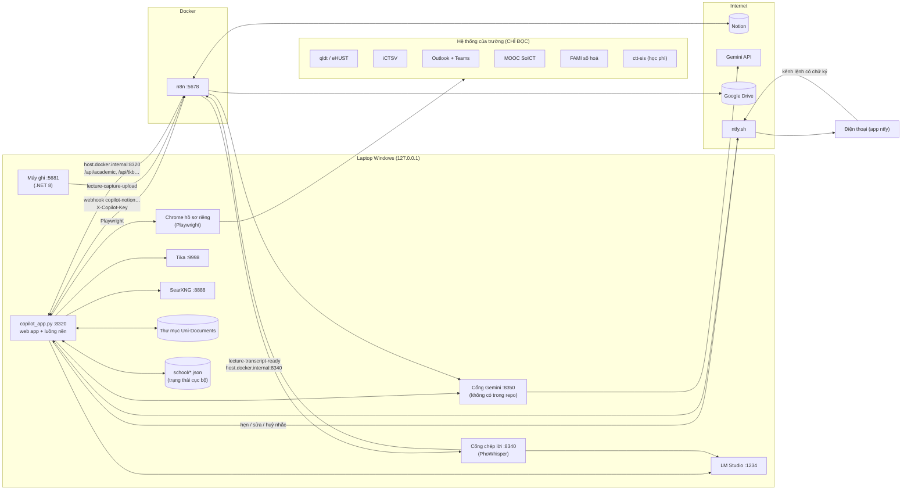
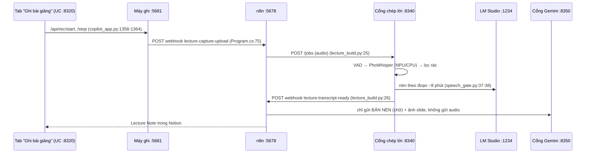

# Kiến trúc University Copilot

> Tài liệu này mô tả **code đang có trên nhánh `main`**. Mỗi khẳng định kèm `file:dòng` để bạn tự đối chiếu.
> Chỗ nào code không đủ để khẳng định thì ghi **⚠️ cần chủ repo xác nhận**.
> Bản đồ vẽ tay đầy đủ hơn (kèm các phần không có trong repo): [Map.svg](Map.svg), sơ đồ khối n8n: [Map-n8n.svg](Map-n8n.svg).

## 1. Các dịch vụ và cổng

Mọi dịch vụ do repo này chạy đều **chỉ nghe trên `127.0.0.1`** (không mở ra mạng LAN). n8n chạy trong Docker và gọi ngược về máy qua `host.docker.internal`.

| Cổng | Dịch vụ | Chạy bằng | Có trong repo? | Bằng chứng |
|---|---|---|---|---|
| **8320** | Web app UC (giao diện + API cho n8n) | `python copilot_app.py` (hoặc `open_copilot.ps1`) | ✅ | `copilot_app.py:31`, `copilot_app.py:1441`, `open_copilot.ps1:8-11` |
| **5678** | n8n (Docker) — workflow "University — Copilot", Lecture Capture, Lecture Analysis | Docker Desktop | ✅ một phần (xem §4) | `copilot_app.py:26`, `n8napi.py:3`, `build.py:20` |
| **8340** | Cổng chép lời (speech gate): âm thanh → chữ → bản nén | `python speech-gate/speech_gate.py` | ✅ | `speech-gate/speech_gate.py:40`, `:571` |
| **5681** | Máy ghi bài giảng / cuộc họp (C# .NET 8) | `meeting-lecture-recorder/Start-LectureRecorder.ps1` | ✅ | `meeting-lecture-recorder/README.md:3`, `Start-LectureRecorder.ps1:3-4` |
| **8350** | "Cổng Gemini" (đếm quota, chuyển tiếp tới Gemini API) | `gemini_gate.py` | ❌ **không có trong repo** | dùng ở `mail_events.py:18`, `copilot_app.py:181`, `lecture_build.py:27` — ⚠️ cần chủ repo xác nhận cách cài |
| **1234** | LM Studio (API kiểu OpenAI) — model chạy trên máy | LM Studio | ngoài | `copilot_app.py:27`, `speech-gate/speech_gate.py:37`, `pdf_translate.py:61` |
| **9998** | Apache Tika (trích chữ từ PDF/Office) | ⚠️ cần chủ repo xác nhận (Docker hay bản Java) | ngoài | `copilot_app.py:28`, `tuition_rules.py:22`, `course_detail.py:50` |
| **8888** | SearXNG (tìm web cho chat + Research Hub) | Docker ("university-searxng") | ngoài | `web_tools.py:13`, `research.py:92-97` |
| **9333** | Chrome riêng để "Làm bài" (cổng gỡ lỗi từ xa) | UC tự bật | ✅ | `work_open.py:24`, `work_open.py:90-100` |
| 8300 / 8310 | AgentChattr ("Hội đồng AI") + `council_relay.py` | ngoài | ❌ không có trong repo | `ui/index.html:555`, `build.py:496-499`, `build.py:777` — tuỳ chọn, ⚠️ cần chủ repo xác nhận |
| — | ntfy (máy chủ công khai `ntfy.sh`) — đẩy thông báo lên điện thoại | dịch vụ Internet | ngoài | `phone_sched.py:99`, `phone_link.py:58`, `alerts.py:198` |

## 2. Sơ đồ tổng thể

## 3. Luồng nền trong `copilot_app.py`

Khi chạy `python copilot_app.py`, khối `__main__` bật các luồng sau (`copilot_app.py:1420-1441`):

| Luồng | Làm gì | Nhịp | Bằng chứng |
|---|---|---|---|
| `worker` | Xếp file trong "00 · Inbox": Tika đọc chữ → LM Studio chọn thư mục môn → chuyển file → n8n đưa lên Drive + Notion | khi có file | `copilot_app.py:917-925`, `:211-350`, `:301-310` |
| `uni_sync_loop` | Quét thư mục Uni-Documents: file mới / file đã sửa → Drive + 📥 University Inbox | 60 giây | `copilot_app.py:377`, `:908-914` |
| `mail_loop` | Mail + Teams + MOOC + FAMI + phân loại thư + học phí + CTSV nhanh + xuất ghi chú bài giảng + việc hết hạn | đúng khung 5 phút, 24/24 | `copilot_app.py:838-851`, `:764-825` |
| `school_loop` | qldt + iCTSV (`school_fetch.py` chạy tiến trình riêng) → áp vào Notion (`school_sync.py`) | đúng khung 5 phút | `copilot_app.py:745-756`, `school_sync.py:245-252` |
| `alert_loop` | Tính cảnh báo (tiết học 30/15 phút, mốc hạn nộp, sự kiện) → toast + ntfy; cứ 5 phút đối chiếu lịch hẹn ntfy | 60 giây | `copilot_app.py:892-905` |
| `lecture_monitor.loop` | Giám sát chuỗi ghi bài giảng (máy ghi, n8n, cổng chép lời) | 60 giây | `copilot_app.py:1430`, `lecture_monitor.py:224-230` |
| `phone_link.listen` | Nghe kênh lệnh từ điện thoại (ntfy stream) | liên tục | `copilot_app.py:1431`, `phone_link.py:153-170` |
| `_audio_priority_loop` | Chỉ chạy khi đã cài add-on "máy yếu" | 5 giây | `copilot_app.py:881-889` |
| `_mode_loop` | Chép "chế độ hôm nay" sang 🎛️ University Control | 10 phút | `copilot_app.py:1433-1439` |

**"Đúng khung 5 phút"**: các khung 00:00, 00:05 … 23:55 (`copilot_app.py:688`). Tới khung mà máy đang thức thì chạy; lỡ khung quá 120 giây (máy ngủ / tắt) thì **bỏ, không chạy bù** (`copilot_app.py:689-695`).

## 4. Luồng dữ liệu chính

### 4.1. UC ⇄ Notion luôn đi qua n8n
- UC **không** gọi Notion API trực tiếp: lớp `academic.Notion` gửi danh sách thao tác tới webhook n8n `copilot-notion` (`academic.py:71-83`), n8n dùng credential Notion của nó.
- UC gọi n8n kèm header `X-Copilot-Key` = nội dung file `.copilot-secret` (`copilot_app.py:25`, `:159-160`).
- n8n gọi ngược các công cụ của UC (`/api/academic`, `/api/tkb`, `/api/reschedule`, `/api/web/search`…) tại `host.docker.internal:8320` (`build.py:443-491`), UC kiểm tra cùng header (`copilot_app.py:1114-1197`).

### 4.2. Dữ liệu trường → Notion (luật "dữ liệu trường cao nhất")
1. `school_fetch.py` mở Chrome thật (Playwright, `channel="chrome"`, `school_fetch.py:42`) bằng hồ sơ riêng `paths.chrome_profile` (`school_fetch.py:20`), đọc qldt + iCTSV, ghi `school/latest.json`.
2. `school_sync.py` so với Notion: thiếu → thêm, khác → sửa theo trường, thừa → giữ (`school_sync.py:1-21`), ghi nhật ký 🏫 Đồng bộ trường (`school_sync.py:224-230`).

### 4.3. Mail / Teams → sự kiện → nhắc
1. `school_mail.py`, `teams_fetch.py` đọc thư và bài đăng (chỉ đọc).
2. `mail_events.py` gửi từng thư cho Gemini **qua cổng :8350** để trích các "chặng" (tên, ngày, giờ, địa điểm) (`mail_events.py:18`, `:51-73`); code so chặng mới với chặng cũ để ra dòng *Trước → Nay* (`mail_events.py:94-115`).
3. `alerts.py` leo thang vàng / đỏ / ghim và gửi toast Windows (`alerts.py:1-9`, `:173-186`); `phone_sched.py` hẹn trước các lần nhắc trên ntfy tới 70 giờ (`phone_sched.py:18`, `:110-134`).
4. Mốc nhắc hạn nộp theo "Loại hạn" (`deadlines.py:28-31`).

### 4.4. Tài liệu
Thả file vào Uni-Documents hoặc tải qua tab Inbox → (nếu ở gốc) agent xếp thư mục → chống trùng SHA-256 → n8n `copilot-file-ingest` đưa lên Drive + 📥 University Inbox (`copilot_app.py:292-312`, `:409-418`, `:520-557`, `:632-685`). File trên máy không bao giờ bị hệ thống xoá (`copilot_app.py:418`).

### 4.5. Ghi bài giảng

Audio **không bao giờ** gửi cho Gemini (`speech-gate/README.md:5`, `speech-gate/speech_gate.py:3`).

### 4.6. Điện thoại
- UC → điện thoại: kênh `topic` trong `school/ntfy.json` (`phone_link.py:4`, `alerts.py:192`).
- Điện thoại → UC: kênh `cmd_topic` (UC tự tạo nếu chưa có, `phone_link.py:21-25`). Lệnh ghi phải có chữ ký HMAC bằng `.copilot-secret`, hết hạn sau 48 giờ, dùng một lần (`phone_link.py:6-7`, `:17-18`, `:41-52`).

## 5. Dữ liệu cục bộ

| Ở đâu | Gì | Bằng chứng |
|---|---|---|
| `config.json` | ID database Notion, ID credential n8n, ID workflow n8n, đường dẫn | `uc_config.py:11-40` |
| `.copilot-secret` | khoá chung: ký link nội bộ, header `X-Copilot-Key`, chữ ký lệnh điện thoại | `copilot_app.py:25`, `phone_link.py:17`, `speech-gate/speech_gate.py:39` |
| `school/` | mọi trạng thái và dữ liệu đọc từ trường (JSON) | `.gitignore:8` |
| Windows Credential Manager, mục `uc-school-sync` | email + mật khẩu tài khoản trường | `school_cred.py:4`, `:15` |
| Biến môi trường User | `GEMINI_API_KEY`, `N8N_API_KEY` | `mail_events.py:54-57`, `n8napi.py:5-8` |

Toàn bộ các file trên đều nằm trong `.gitignore` (`.gitignore:1-16`), không đưa lên Git.
