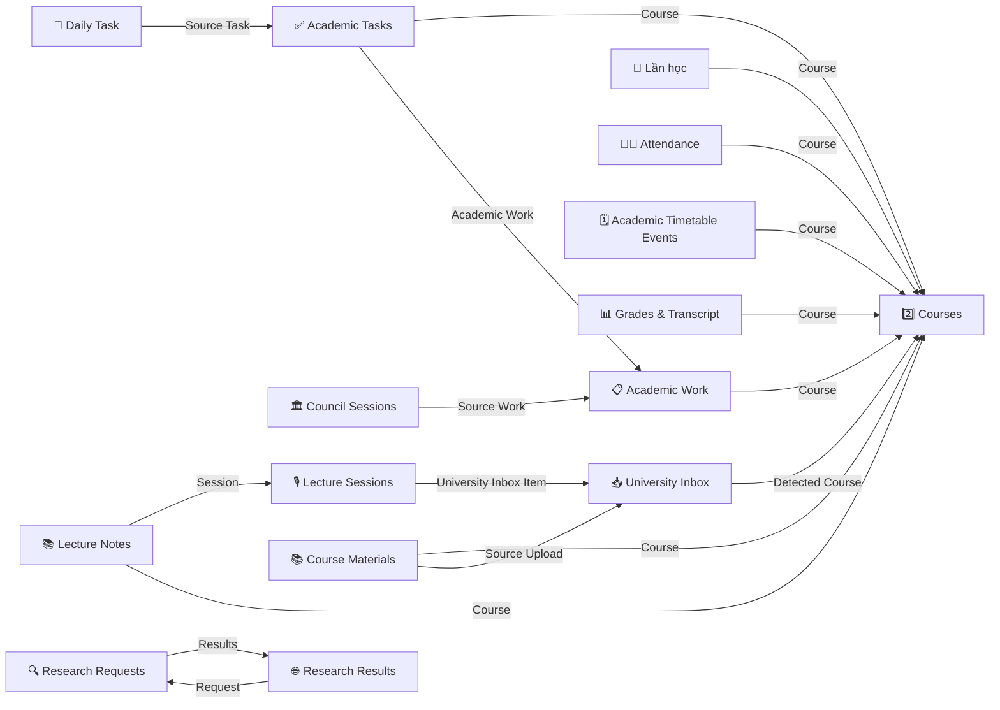

# Schema Notion của University Copilot

> Rút ra **từ code** ở `main` v1.00.28 (`40aa404`), để người khác dựng lại workspace mà không phải đoán.
> Bộ dựng tự động: [`tools/notion_setup.py`](../tools/notion_setup.py), đọc cùng dữ liệu với tài liệu này: [`tools/notion_schema.json`](../tools/notion_schema.json).

## Cách đọc

| Nhãn | Nghĩa |
|---|---|
| **[Đọc]** | Code ghi hoặc lọc thuộc tính **đúng kiểu này**: payload có dạng `{"select": …}`, bộ lọc `"status": {…}`… Cột "Bằng chứng" trỏ tới chỗ đó. |
| **[Suy luận]** — "suy ra" | Code chỉ **đọc** thuộc tính qua hàm chung `academic.P()` (hàm này đọc được mọi kiểu), hoặc kiểu được đoán từ cách dùng. Kiểu ghi ở đây là lựa chọn hợp lý nhất, **không chắc chắn**. |
| **[Chạy]** | Đã chạy thử. Chỉ áp cho bộ dựng: chạy với Notion giả trong `tests/test_notion_setup.py`, **chưa chạy với Notion thật**. |

Tên thuộc tính phải **đúng từng ký tự**, kể cả dấu tiếng Việt và hoa / thường, vì code tìm cột theo tên.

## Tổng quan

- **36 database** và **2 trang thường**, khớp đủ 38 khoá `notion.*` trong `config.example.json`.
- **315 thuộc tính**: 275 [Đọc], 40 suy ra.
- Theo kiểu: rich_text 92, select 62, number 43, title 36, date 29, relation 17, checkbox 15, url 10, status 9, files 1, multi_select 1.
- **17 quan hệ** (relation). **Không có** formula hay rollup nào được code gọi tên.
- **4 database cần sẵn "dòng mồi"** vì code đọc dòng đầu tiên hoặc một dòng có tên cố định. Bộ dựng tự tạo các dòng này khi database còn trống.

## Dựng workspace bằng `tools/notion_setup.py`

1. Tạo integration Notion (Settings → Connections → Develop or manage integrations), lấy token.
2. Tạo một trang trống (vd "University Copilot"), share trang đó cho integration (••• → Connections).
3. Chạy trong PowerShell:
   ```powershell
   py tools\notion_setup.py --dry-run                      # xem kế hoạch, không gọi mạng, không cần token
   $env:NOTION_TOKEN = "<token integration của bạn>"
   py tools\notion_setup.py <ID-hoặc-URL-trang-cha>
   ```
4. Dán khối `"notion": {…}` mà công cụ in ra vào `config.json`, thay khối cũ.
5. Làm các việc ở mục **Việc phải làm tay** dưới đây.

Hành vi:
- **Chạy lại không tạo trùng.** Công cụ dò database / trang con **theo tên** trên trang cha. Cái đã có thì dùng lại, chỉ **thêm** thuộc tính còn thiếu, không đổi kiểu, không xoá gì. Cột có sẵn mà sai kiểu thì công cụ cảnh báo, không tự sửa.
- **Quan hệ được thêm sau**, khi đã có đủ database.
- **Dòng mồi chỉ được tạo khi database đang trống.**
- Dùng API Notion bản `2022-06-28` (ID database, giống n8n). Gặp 429 / 5xx thì tự thử lại.
- Công cụ không ghi file nào; ID chỉ được in ra màn hình.

## Việc phải làm tay

1. **Thuộc tính kiểu Status.** Theo tài liệu API Notion, API không tạo được thuộc tính status kèm lựa chọn [Suy luận, cần kiểm khi chạy thật]. Công cụ bỏ qua các cột này; hãy thêm tay, **đúng tên và đúng lựa chọn**:

   | Database | Thuộc tính | Lựa chọn | Nhóm "Complete" (suy ra) | Bằng chứng |
   |---|---|---|---|---|
   | ✅ Academic Tasks | `Status` | To do, Doing, Done | Done (expired.py:5) | `build.py:300 (lọc status does_not_equal Done); build.py:433 mô tả công cụ 'To do \| Doing \| Done'; semester.py:137 'To do'; expired.py:77 'Done'` |
   | 📋 Academic Work | `Status` | Not started, Submitted, Graded | Submitted, Graded (deadlines.py:22) | `academic.py:464; deadlines.py:22,135; build.py:302 (lọc status)` |
   | 2️⃣ Courses | `Status` | Planned, Taking, Completed | Completed | `build.py:293 (lọc status equals Taking); semester.py:103,107; tkb.py:142` |
   | 📅 Daily Task | `Status` | Not started, In progress, Done | Done | `build.py:428-430; daymode.py:116` |
   | 📥 University Inbox | `Triage Status` | Not started, In progress | — | `build.py:689; copilot_app.py:605 (lọc status); build.py:1294 ('In progress')` |
   | ➕ Academic Intake | `Status` | Not started | — | `build.py:426` |
   | 🧠 NotebookLM Inbox | `Status` | Not started | — | `build.py:478` |
   | 🔍 Research Requests | `Status` | Not started, In progress, Done | Done | `research.py:40,50,62,64` |
   | ☀️ Summer Planning | `Status` | Not started, In progress, Done | Done | `semester.py:142,241; program.py:379` |

   Đừng đổi các cột Status của Exception Queue, Exam Revision, Council Sessions, Backup, Weekly Reviews và Attendance: code dùng chúng kiểu **select**, công cụ đã tạo đúng.
2. **Dữ liệu tham chiếu.** Bạn tự nhập vào: 📚 Danh mục chứng chỉ ngoại ngữ, 📏 Quy định miễn học phần ngoại ngữ, ⚙️ Mốc năm học (không bắt buộc, vì `semester_calendar.json` có giá trị mặc định), và cột `Required Credits` của Semester Credit Tracker.
3. **Năm học của bạn.** Đặt `UC_INTAKE_YEAR` cho đúng khoá (xem `school_sync.py:39`).
4. **Vị trí.** Code chú thích rằng 🎓 Xét tốt nghiệp và 🎫 Chứng chỉ ngoại ngữ của tôi nằm trên trang Home Dashboard. Công cụ tạo cả hai ngay trên trang cha; muốn thì kéo chúng vào Home Dashboard (ID không đổi).
5. **Workflow n8n.** Các workflow cũ A1–A4, S5, S6, C9, H10, R10, QU dựng từ file mẫu **không có trong repo** (`build.py:101`). Cột mà chỉ các mẫu đó ghi thì không suy ra được từ code (xem "Còn mơ hồ").

## Sơ đồ quan hệ



Mọi quan hệ được tạo **một chiều** (`single_property`). Code không cho biết quan hệ nào là hai chiều [Suy luận]. Riêng Research Requests.`Results` và Research Results.`Request`: code ghi cả hai phía (`research.py:179`, `:199`), nên hai quan hệ một chiều vẫn chạy đúng.

## Từng database

### ✅ Academic Tasks — `notion.academic_tasks`

Việc con chia nhỏ từ Academic Work (A3) và bản ghi việc của trường đã hết hạn; A4 xếp vào Daily Task.

- Biểu tượng / tên: `expired.py:2; docs/gen_map.py:311; docs/gen_n8n_map.py:159`
- Đọc: `build.py:snapshot_chain ('Task chưa xong')`; `weekly.py:build/done_hours`; `dupscan.py:plan_drop`; `deadlines.py:fix_due`; `reschedule.py:run`; `expired.py:record`
- Ghi: `semester.py:khai_xuan`; `expired.py:record`; `deadlines.py:fix_due`; `reschedule.py:run`; `build.py:chat tool cap_nhat_task_goc (L431-433)`; `n8n cũ A3/A4 (mẫu ngoài repo)`

| Thuộc tính | Kiểu | Lựa chọn | Nguồn | Bằng chứng | Ghi chú |
|---|---|---|---|---|---|
| **Task** | title |  | [Đọc] | `semester.py:137; expired.py:77` | build.py:240 cũng đọc .title |
| Status | status ✋ | To do, Doing, Done | [Đọc] | `build.py:300 (lọc status does_not_equal Done); build.py:433 mô tả công cụ 'To do \| Doing \| Done'; semester.py:137 'To do'; expired.py:77 'Done'` | "Done" thuộc nhóm Complete (expired.py:5) |
| Due | date |  | [Đọc] | `build.py:299 sắp xếp; semester.py:137; deadlines.py:193; reschedule.py:72` | ngày có giờ |
| Priority | select | Medium | [Đọc] | `semester.py:138` | A3/A4 (mẫu ngoài repo) có thể dùng High / Medium / Low — suy ra |
| Task Kind | select | Admin, Academic | [Đọc] | `semester.py:138; expired.py:77` |  |
| Estimate (hrs) | number |  | [Đọc] | `semester.py:138; expired.py:78; đọc, kiểm kiểu số build.py:214,253` |  |
| Course | relation → Courses |  | [Đọc] | `expired.py:80; build.py:253 R(p,'Course')` | không rõ quan hệ một chiều hay hai chiều |
| Academic Work | relation → Academic Work |  | [Đọc] | `deadlines.py:190 lọc relation contains; reschedule.py:57; build.py:248` | không rõ quan hệ một chiều hay hai chiều |
| Breakdown Key | rich_text |  | [Đọc] | `expired.py:72 (lọc rich_text starts_with 'het-han\|'); expired.py:78` | khoá chống trùng; A3 (mẫu ngoài repo) cũng dùng |
| Kết quả hạn | select | Đã làm, Bỏ lỡ, Không rõ | [Đọc] | `expired.py:79; expired.py:36,62,70` |  |
| Nguồn hạn | rich_text |  | [Đọc] | `expired.py:79` |  |
| Blocked Reason | rich_text |  | suy ra | `weekly.py:51` | đọc qua P(); A3 cũ ghi giá trị bắt đầu bằng "superseded" / "invalid automation" |
| Actual Time (hrs) | number |  | suy ra | `weekly.py:57,105` | đọc qua P() rồi float() |

### 📋 Academic Work — `notion.academic_work`

Hạn nộp / bài thi (của trường và tự đặt), có 3 mức "Loại hạn"; là cha của Academic Tasks.

- Biểu tượng / tên: `build.py:41; reschedule.py:46; docs/gen_n8n_map.py:159`
- Đọc: `build.py:snapshot_chain ('Bài chưa nộp')`; `deadlines.py:_fetch`; `reschedule.py:run`; `checks.py:run`; `weekly.py:build`; `dupscan.py`; `phone_page.py (link_to_page L147)`; `council N9 (Source Work snapshot)`
- Ghi: `academic.py:record (loai=thi)`; `deadlines.py:_fetch/complete/upsert_teams/fix_due`; `reschedule.py:run`; `fami.py:sync`; `mooc.py:sync`; `n8n cũ A1`

| Thuộc tính | Kiểu | Lựa chọn | Nguồn | Bằng chứng | Ghi chú |
|---|---|---|---|---|---|
| **Name** | title |  | [Đọc] | `academic.py:462; deadlines.py:169; fami.py:111` |  |
| Type | select | Midterm, Final, Quiz, Lab, Homework | [Đọc] | `academic.py:462; deadlines.py:172; mooc.py:114; checks.py:52 (lọc select is_not_empty)` | test dùng thêm "Assignment" (tests/test_deadlines.py:122); A1 cũ có thể ghi giá trị khác |
| Due | date |  | [Đọc] | `academic.py:462; deadlines.py:71 (lọc date is_not_empty); deadlines.py:186` |  |
| Loại hạn | select | Môn học, Tự luyện cốt lõi, Tự luyện | [Đọc] | `academic.py:463; deadlines.py:27-30,91; reschedule.py:16` |  |
| Course | relation → Courses |  | [Đọc] | `academic.py:464; deadlines.py:173` | không rõ quan hệ một chiều hay hai chiều |
| Entry Kind | select | Deadline | [Đọc] | `academic.py:464; deadlines.py:70 (lọc select)` | A1 cũ có thể ghi giá trị khác |
| Status | status ✋ | Not started, Submitted, Graded | [Đọc] | `academic.py:464; deadlines.py:22,135; build.py:302 (lọc status)` | Submitted / Graded = đã xong (deadlines.py:22); nhóm Complete — suy ra |
| Location | rich_text |  | [Đọc] | `academic.py:465; fami.py:114` |  |
| Workload Status | select | Needs review | [Đọc] | `deadlines.py:171; fami.py:112; mooc.py:115` |  |
| Submission/Repo | url |  | [Đọc] | `fami.py:113; mooc.py:115; reschedule.py:50` |  |
| Weight % | number |  | suy ra | `deadlines.py:81 (P()); tests/test_deadlines.py:122 dữ liệu test ('number')` |  |

### 🔁 Lần học — `notion.attempts`

Lịch sử các lần học một môn (trượt trước khi học lại, đạt trước khi học cải thiện).

- Biểu tượng / tên: `build.py:51; academic.py:19; docs/gen_n8n_map.py:162`
- Đọc: `academic.py:Notion.attempts/attempts_by_course`; `program.py:build, undo-improve (L442)`
- Ghi: `academic.py:record_attempt (gọi từ semester.py:close_out, program.py)`; `program.py (L452 Loại=Đã huỷ)`

| Thuộc tính | Kiểu | Lựa chọn | Nguồn | Bằng chứng | Ghi chú |
|---|---|---|---|---|---|
| **Lần** | title |  | [Đọc] | `academic.py:193` |  |
| Course | relation → Courses |  | [Đọc] | `academic.py:193; program.py:442 (lọc relation contains)` |  |
| Semester | select | S1, S2, S3, S4, S5, S6, S7, S8 | [Đọc] | `academic.py:194` | S1…S8 |
| GPA 4 | number |  | [Đọc] | `academic.py:194` |  |
| Tín | number |  | [Đọc] | `academic.py:194` |  |
| Loại | select | Lần đầu, Học lại, Cải thiện, Đã huỷ | [Đọc] | `academic.py:191,195; program.py:452` |  |
| Ghi lúc | date |  | [Đọc] | `academic.py:195` |  |
| Kết quả | select | Pass, Fail | [Đọc] | `academic.py:196` |  |

### 🧑‍🏫 Attendance — `notion.attendance`

Mỗi dòng là một buổi vắng / muộn / có phép do bạn báo.

- Biểu tượng / tên: `build.py:37; docs/gen_n8n_map.py:162`
- Đọc: `academic.py:course_status`; `program.py:build`; `weekly.py:build`; `build.py:academic_section ('Học kỳ · Chuyên cần')`
- Ghi: `academic.py:record (loai=vang)`

| Thuộc tính | Kiểu | Lựa chọn | Nguồn | Bằng chứng | Ghi chú |
|---|---|---|---|---|---|
| **Session** | title |  | [Đọc] | `academic.py:504` |  |
| Course | relation → Courses |  | [Đọc] | `academic.py:505` |  |
| Date | date |  | [Đọc] | `academic.py:505` |  |
| Status | select | Absent, Late, Excused | [Đọc] | `academic.py:506; build.py:1035` | kiểu select, KHÔNG phải status |
| Notes | rich_text |  | [Đọc] | `academic.py:506` |  |

### 💾 Backup & Drive Sync — `notion.backup`

Sổ sao lưu tài liệu lên Drive: mã băm SHA-256, link Drive, trạng thái trùng / cập nhật.

- Biểu tượng / tên: `build.py:47; copilot_app.py:366`
- Ghi: `copilot_app.py:backup_log`; `copilot_app.py:backup_patch`

| Thuộc tính | Kiểu | Lựa chọn | Nguồn | Bằng chứng | Ghi chú |
|---|---|---|---|---|---|
| **Item** | title |  | [Đọc] | `copilot_app.py:388` |  |
| Type | select | Course Material | [Đọc] | `copilot_app.py:389` |  |
| Status | select | Synced, Needs review, Duplicate, Superseded, Updated | [Đọc] | `copilot_app.py:389,501,529,549,573,592` | kiểu select, KHÔNG phải status |
| SHA-256 | rich_text |  | [Đọc] | `copilot_app.py:390` |  |
| Drive URL | url |  | [Đọc] | `copilot_app.py:391` |  |
| Source URL | url |  | [Đọc] | `copilot_app.py:391` | dạng file:/// |
| Last Sync | date |  | [Đọc] | `copilot_app.py:392` |  |
| Notes | rich_text |  | [Đọc] | `copilot_app.py:393` |  |

### 🗓️ Academic Timetable Events — `notion.calendar_events`

Lịch học, lịch thi và sự kiện theo giờ (UC ghi từ TKB qldt, lịch thi, thư).

- Biểu tượng / tên: `docs/gen_n8n_map.py:159; extracurricular.py:9`
- Đọc: `build.py:snapshot_chain ('Lịch 7 ngày'), academic_section ('Lịch ·'), cổng copilot-tkb-archive`; `timetable.py`; `tkb.py:run`; `dupscan.py`; `mail_events.py:patch_classes`; `lecture_build.py ('Tìm tiết học trùng giờ')`; `phone_page.py`
- Ghi: `tkb.py:run`; `academic.py:record (thi)`; `mail_events.py:sync_notion/patch_classes`; `deadlines.py:fix_due`; `reschedule.py:run`; `n8n cũ A1`

| Thuộc tính | Kiểu | Lựa chọn | Nguồn | Bằng chứng | Ghi chú |
|---|---|---|---|---|---|
| **Event** | title |  | [Đọc] | `tkb.py:137; academic.py:466; build.py:1057 (lọc title does_not_contain)` |  |
| Kind | select | Class, Deadline, Event | [Đọc] | `tkb.py:126,137; academic.py:466; mail_events.py:413; build.py:1127` |  |
| When | date |  | [Đọc] | `tkb.py:138 (start+end); build.py:295 (lọc/sắp xếp)` | khoảng ngày giờ, múi +07:00 |
| Course | relation → Courses |  | [Đọc] | `tkb.py:137; academic.py:467` |  |
| Location | rich_text |  | [Đọc] | `tkb.py:138; academic.py:467` |  |
| Notes | rich_text |  | [Đọc] | `tkb.py:138; academic.py:468` |  |
| Sync Key | rich_text |  | [Đọc] | `tkb.py:139; deadlines.py:188 (lọc rich_text equals 'deadline\|<work_id>'); mail_events.py:406 (starts_with 'mail\|')` | khoá chống trùng: "<kỳ>\|<mã>\|<loại>\|<ngày>\|<giờ>", "exam\|…", "deadline\|<id>", "mail\|…" |

### 📚 Danh mục chứng chỉ ngoại ngữ (ĐHBK công nhận) — `notion.cert_catalog`

Danh mục chứng chỉ ngoại ngữ trường công nhận (dữ liệu tham chiếu, bạn tự nhập).

- Biểu tượng / tên: `certs.py:5; docs/gen_n8n_map.py:164`
- Đọc: `certs.py:catalog`
- Ghi: `certs_setup.py (nhắc ở certs.py:4, KHÔNG có trong repo)`

| Thuộc tính | Kiểu | Lựa chọn | Nguồn | Bằng chứng | Ghi chú |
|---|---|---|---|---|---|
| **Band** | title |  | suy ra | `certs.py:40` | giá trị dạng "<Chứng chỉ> · <band>"; chọn làm cột tiêu đề là giả định |
| Chứng chỉ | select |  | suy ra | `certs.py:40,54,58` | đọc qua P(); có thể là rich_text. Code chỉ biết dòng TOEIC 4 kỹ năng có tên bắt đầu "TOEIC 4 kỹ năng · " (certs.py:20, :54); không có danh sách lựa chọn — bạn tự nhập |
| Ngôn ngữ | select | Tiếng Anh | suy ra | `certs.py:40,70` |  |
| Bậc | rich_text |  | suy ra | `certs.py:41` | có thể là select |
| Bậc số | number |  | suy ra | `certs.py:41,79` | so sánh số (min, >=) |
| CEFR | select |  | suy ra | `certs.py:41` | có thể là rich_text |
| Hiệu lực (tháng) | number |  | suy ra | `certs.py:41,84 int(months)` |  |
| Xét chuẩn đầu ra | checkbox |  | suy ra | `certs.py:42 bool(P())` |  |
| Thứ tự | number |  | suy ra | `certs.py:42,44 sắp xếp` |  |
| Ghi chú | rich_text |  | suy ra | `certs.py:42` |  |
| Nguồn | rich_text |  | suy ra | `certs.py:42` | có thể là url |

### 📏 Quy định miễn học phần ngoại ngữ (K70) — `notion.cert_rules`

Quy định miễn học phần ngoại ngữ theo bậc (dữ liệu tham chiếu, bạn tự nhập).

- Biểu tượng / tên: `certs.py:6`
- Đọc: `certs.py:catalog`; `program.py:build (qua certs)`
- Ghi: `certs_setup.py (ngoài repo)`

| Thuộc tính | Kiểu | Lựa chọn | Nguồn | Bằng chứng | Ghi chú |
|---|---|---|---|---|---|
| **Mã** | title |  | suy ra | `certs.py:45,88` | Chọn "Mã" làm cột tiêu đề (code đọc qua P() nên title hay rich_text đều được); giả định. |
| Học phần | rich_text |  | suy ra | `certs.py:45` | cũng có thể là cột tiêu đề |
| Miễn từ bậc | number |  | suy ra | `certs.py:45,88-89 (lvn >= r['lv']; mặc định 3.1)` |  |
| Xếp lớp / đăng ký | rich_text |  | suy ra | `certs.py:45` |  |
| Điều kiện | rich_text |  | suy ra | `certs.py:46` |  |

### 🎫 Chứng chỉ ngoại ngữ của tôi — `notion.cert_mine`

Chứng chỉ ngoại ngữ của bạn (mục tiêu / đã có / hết hạn); UC tính bậc, miễn học phần, chuẩn đầu ra.

- Biểu tượng / tên: `certs.py:7`
- Đọc: `certs.py:_mine/build`; `program.py:build`
- Ghi: `certs.py:build (sync), certs.py:save`; `semester.py:tick (calls certs.build)`

| Thuộc tính | Kiểu | Lựa chọn | Nguồn | Bằng chứng | Ghi chú |
|---|---|---|---|---|---|
| **Tên** | title |  | [Đọc] | `certs.py:175` |  |
| Mục | select | Mục tiêu, Đã có, Đã hết hạn, Đã xoá | [Đọc] | `certs.py:124,147,175` |  |
| Chứng chỉ | select | TOEIC 4 kỹ năng | [Đọc] | `certs.py:175` | lựa chọn = tên chứng chỉ trong danh mục |
| Ngôn ngữ | select | Tiếng Anh | [Đọc] | `certs.py:176` |  |
| Band | rich_text |  | [Đọc] | `certs.py:176` |  |
| Chi tiết | rich_text |  | [Đọc] | `certs.py:176` | JSON điểm từng phần TOEIC |
| Ngày cấp | date |  | [Đọc] | `certs.py:177` |  |
| Ngày hết hạn | date |  | [Đọc] | `certs.py:126,177` |  |
| Quên ngày cấp | checkbox |  | [Đọc] | `certs.py:178` |  |
| Ghi chú | rich_text |  | [Đọc] | `certs.py:178` |  |
| Bậc | rich_text |  | [Đọc] | `certs.py:124` | vd "Bậc 3" |
| Bậc số | number |  | [Đọc] | `certs.py:124` |  |
| Miễn học phần | rich_text |  | [Đọc] | `certs.py:125` |  |
| Đạt chuẩn đầu ra | checkbox |  | [Đọc] | `certs.py:125` |  |

### 🏅 Điểm rèn luyện — `notion.conduct`

Điểm rèn luyện theo kỳ (S1…S8).

- Biểu tượng / tên: build.py:38; school_sync.py:11; docs/gen_n8n_map.py:162; build.py:38 — chọn 🏅 theo build.py:38 (school_sync.py:11 ghi ⭐)
- Đọc: `academic.py:summary`; `program.py:build`; `school_sync.py:apply`
- Ghi: `academic.py:record (ren_luyen)`; `school_sync.py:apply`

| Thuộc tính | Kiểu | Lựa chọn | Nguồn | Bằng chứng | Ghi chú |
|---|---|---|---|---|---|
| **Kỳ** | title |  | [Đọc] | `academic.py:369; school_sync.py:222` |  |
| Semester | select | S1, S2, S3, S4, S5, S6, S7, S8 | [Đọc] | `academic.py:368 (lọc select),369` |  |
| Điểm | number |  | [Đọc] | `academic.py:369; school_sync.py:223` | 0–100 |
| Ghi chú | rich_text |  | [Đọc] | `academic.py:370` |  |

### 🎛️ University Control — `notion.control`

Một dòng điều khiển: chế độ hôm nay (Camp / Rest) cho bộ xếp lịch A4.

- Biểu tượng / tên: `build.py:46; daymode.py:6`
- Đọc: `daymode.py:camp_default/sync_control`; `weekly.py:build`; `legacy A4 template`
- Ghi: `daymode.py:sync_control`; `H10 Health Ping cũ (không rõ cột)`
- **Dòng mồi** (1): {"Name": "University Control", "Camp Mode": false, "Rest Mode": false, "Camp Hours": 6} — vì `daymode.py:37,44 (next(iter(nt.query(CONTROL))) — không có dòng thì bỏ qua)`

| Thuộc tính | Kiểu | Lựa chọn | Nguồn | Bằng chứng | Ghi chú |
|---|---|---|---|---|---|
| **Name** | title |  | suy ra | — | Code không đọc cột tiêu đề của DB này; tên "Name" là giả định (đổi tên không ảnh hưởng code). |
| Camp Mode | checkbox |  | [Đọc] | `daymode.py:48,51; build.py:1311` |  |
| Rest Mode | checkbox |  | [Đọc] | `daymode.py:48,51; build.py:1312` |  |
| Chế độ hôm nay | rich_text |  | [Đọc] | `daymode.py:48,51` |  |
| Camp Hours | number |  | [Đọc] | `daymode.py:49,51; daymode.py:38` | mặc định 6 |

### 🏛️ Council Sessions — `notion.council_sessions`

Phiên "Hội đồng AI" (AgentChattr): đề bài, bản ghi thảo luận, kết luận.

- Biểu tượng / tên: `build.py:776; agentchattr/council_relay.py:6`
- Đọc: `build.py:council_section (N9)`
- Ghi: `build.py:council_section (N9)`; `legacy C9 template (council-convene/finalize; patched build.py:1323-1331)`

| Thuộc tính | Kiểu | Lựa chọn | Nguồn | Bằng chứng | Ghi chú |
|---|---|---|---|---|---|
| **Session** | title |  | suy ra | `build.py:788 (đọc rich_text\|\|title)` | C9 gửi "session" (agentchattr/council_relay.py:234); đọc qua hàm rich_text\|\|title |
| Status | select | Draft, Convened, In council, Awaiting Chair, Finalized | [Đọc] | `build.py:785,793-795,834,842,860,1328` | kiểu select, KHÔNG phải status |
| Convene | checkbox |  | [Đọc] | `build.py:887 (lọc checkbox); build.py:831` |  |
| Chair Prompt | rich_text |  | suy ra | `build.py:786` | đọc qua hàm rich_text\|\|title |
| Final Decision | rich_text |  | suy ra | `build.py:787` |  |
| Source Work | relation → Academic Work |  | suy ra | `build.py:789 (.relation)` | DB đích không ghi rõ trong code; suy ra Academic Work từ tên. |
| Session Key | rich_text |  | [Đọc] | `build.py:834; build.py:923 (lọc rich_text equals)` | dạng "CS-YYYYMMDD-HHMMSS" |
| Snapshot | rich_text |  | [Đọc] | `build.py:834` |  |
| Transcript | rich_text |  | [Đọc] | `build.py:859` | tối đa 100 đoạn |

### 2️⃣ Courses — `notion.courses`

Danh sách môn học: mã, tín, kỳ, trạng thái, kết quả, luật môn, điểm của trường.

- Biểu tượng / tên: `docs/gen_map.py:311; docs/gen_n8n_map.py:161`
- Đọc: `academic.py:Notion.courses/course_view (used by nearly all modules)`; `build.py:snapshot_chain, academic_section`; `program.py`; `school_sync.py`; `tkb.py`; `research.py`; `checks.py`; `deadlines.py`; `lecture_export.py`; `fami.py`; `mooc.py`; `expired.py`
- Ghi: `academic.py:record/apply_overall`; `semester.py:close_out/answer/tick`; `program.py (retake/improve/undo)`; `school_sync.py:apply`; `tkb.py:run`

| Thuộc tính | Kiểu | Lựa chọn | Nguồn | Bằng chứng | Ghi chú |
|---|---|---|---|---|---|
| **Name** | title |  | [Đọc] | `school_sync.py:170; build.py:225 (T)` | lecture_export.py:66 đọc nhầm như rich_text (lỗi nhỏ của app, tên môn ra rỗng) — đừng tạo Name kiểu rich_text |
| Code | rich_text |  | [Đọc] | `school_sync.py:170; build.py:225 (X)` | vd MI1111 |
| Credits | number |  | [Đọc] | `school_sync.py:170,182` |  |
| Status | status ✋ | Planned, Taking, Completed | [Đọc] | `build.py:293 (lọc status equals Taking); semester.py:103,107; tkb.py:142` | nhóm — suy ra: Planned = To-do, Taking = In progress, Completed = Complete |
| Semester | select | S1, S2, S3, S4, S5, S6, S7, S8 | [Đọc] | `semester.py:106; build.py:1063 (lọc select)` | có thể để trống (program.py:326) |
| Result | select | Unknown, Pass, Fail, Miễn (R), Not Taken - Other Module | [Đọc] | `school_sync.py:171; academic.py:317,442; semester.py:258` |  |
| Category | select | Môn Đại cương, Chính trị, Thể chất, Cử nhân, Thực hành, Kỹ năng mềm, Môn Cơ sở ngành, Môn Chuyên ngành | [Đọc] | `school_sync.py:56-58,171` |  |
| Nhóm HP (trường) | rich_text |  | [Đọc] | `school_sync.py:172,185` |  |
| Kỳ gợi ý | rich_text |  | [Đọc] | `school_sync.py:175` | số ghi dạng chữ, vd "3" |
| Nhóm tự chọn | select | GDTC | [Đọc] | `school_sync.py:176; program.py:52` |  |
| Course Notes | rich_text |  | [Đọc] | `school_sync.py:173; semester.py:108` |  |
| Retake | checkbox |  | [Đọc] | `semester.py:106; program.py:402` |  |
| Học cải thiện | checkbox |  | [Đọc] | `program.py:429,449` |  |
| Remaining Credits | number |  | [Đọc] | `semester.py:107; program.py:405` |  |
| Current GPA 4 | number |  | [Đọc] | `academic.py:317; school_sync.py:190` | có thể trống |
| GPA 4 lần trước | number |  | [Đọc] | `semester.py:109; program.py:406` |  |
| Original Semester | select | S1, S2, S3, S4, S5, S6, S7, S8 | [Đọc] | `semester.py:110; tkb.py:145` |  |
| Luật môn | rich_text |  | [Đọc] | `academic.py:387` |  |
| Trọng số QT (%) | number |  | [Đọc] | `academic.py:390` |  |
| Vắng tối đa | number |  | [Đọc] | `academic.py:392` |  |
| Attendance Risk | select | OK, Watch, At Risk | [Đọc] | `academic.py:511-512` |  |
| Vắng (trường) | number |  | [Đọc] | `school_sync.py:142` |  |
| Điểm thành phần (trường) | rich_text |  | [Đọc] | `school_sync.py:151` |  |
| Module/Track | select | Module 1, Module 2, Module 3 | suy ra | `academic.py:142; semester.py:156,257` | so với "Module N"; code không ghi — suy ra từ phép so |

### Semester Credit Tracker — `notion.credit_tracker`

Tín chỉ theo kỳ (Semester 1…8): kế hoạch, đã xong, GPA / CPA của trường.

- Biểu tượng / tên: `build.py:35; docs/gen_n8n_map.py:161`
- Đọc: `program.py:build`; `build.py:academic_section ('Học kỳ · Tín chỉ')`; `semester.py:credit_sync`; `school_sync.py:apply`
- Ghi: `semester.py:credit_sync`; `school_sync.py:apply`
- **Dòng mồi** (8): {"Semester": "Semester 1", "Order": 1}; {"Semester": "Semester 2", "Order": 2}; {"Semester": "Semester 3", "Order": 3} … — vì `semester.py:160 ('S' + Semester.split()[-1]); Required Credits để trống — tự điền theo CTĐT`

| Thuộc tính | Kiểu | Lựa chọn | Nguồn | Bằng chứng | Ghi chú |
|---|---|---|---|---|---|
| **Semester** | title |  | suy ra | `semester.py:160; program.py:85; school_sync.py:199` | giá trị phải kết thúc bằng " <n>", vd "Semester 1" (code lấy "S" + từ cuối) |
| Order | number |  | suy ra | `build.py:1027-1028 (sắp xếp)` |  |
| Required Credits | number |  | suy ra | `semester.py:161; build.py:1027` | code chỉ đọc; bạn tự điền theo CTĐT |
| Planned Credits | number |  | [Đọc] | `semester.py:170,173` |  |
| Completed Credits | number |  | [Đọc] | `semester.py:170,173` |  |
| Tín chỉ chung | number |  | [Đọc] | `semester.py:170,173` |  |
| Tín chỉ Module | rich_text |  | [Đọc] | `semester.py:163,170,173` | chuỗi |
| Đối soát | rich_text |  | [Đọc] | `semester.py:170,173` |  |
| GPA (trường) | number |  | [Đọc] | `school_sync.py:210,214` |  |
| CPA (trường) | number |  | [Đọc] | `school_sync.py:210,214` |  |
| TC tích luỹ (trường) | number |  | [Đọc] | `school_sync.py:210,214` |  |
| TC nợ (trường) | number |  | [Đọc] | `school_sync.py:211,214` |  |
| Cảnh báo (trường) | rich_text |  | [Đọc] | `school_sync.py:216` |  |
| ĐRL đang chấm (trường) | rich_text |  | [Đọc] | `school_sync.py:229` |  |

### 🗞️ Bản tin Copilot — `notion.daily_brief`

Bản tin sáng / tối do n8n viết (model LM Studio).

- Biểu tượng / tên: `build.py:617; docs/gen_n8n_map.py:169`
- Đọc: `ui/index.html:557 (chỉ mở link)`
- Ghi: `build.py:brief_section ('Bản tin · Lưu vào Notion')`

| Thuộc tính | Kiểu | Lựa chọn | Nguồn | Bằng chứng | Ghi chú |
|---|---|---|---|---|---|
| **Bản tin** | title |  | [Đọc] | `build.py:561` | "Bản tin sáng\|tối YYYY-MM-DD"; biểu tượng trang ☀️/🌙 |
| Loại | select | Sáng, Tối | [Đọc] | `build.py:561; build.py:202` |  |
| Ngày | date |  | [Đọc] | `build.py:562` |  |
| Model | rich_text |  | [Đọc] | `build.py:562` |  |

### 📅 Daily Task — `notion.daily_plan`

Việc theo ngày (A4 xếp từ Academic Tasks).

- Biểu tượng / tên: `docs/gen_n8n_map.py:159; weekly.py:39`
- Đọc: `build.py:snapshot_chain ('Việc hôm nay')`; `daymode.py:today_view`; `weekly.py:build`; `dupscan.py:plan_drop`
- Ghi: `daymode.py:mark_daily`; `build.py chat tool cap_nhat_viec_hom_nay (L428-430)`; `legacy A4`

| Thuộc tính | Kiểu | Lựa chọn | Nguồn | Bằng chứng | Ghi chú |
|---|---|---|---|---|---|
| **Task** | title |  | [Đọc] | `build.py:240 (T đọc .title); daymode.py:95` | A4 cũ ghi |
| Status | status ✋ | Not started, In progress, Done | [Đọc] | `build.py:428-430; daymode.py:116` |  |
| Date | date |  | [Đọc] | `build.py:297 (lọc date equals); daymode.py:94` |  |
| Estimate (hrs) | number |  | [Đọc] | `build.py:240 (N kiểm kiểu số)` |  |
| Priority | select | High, Medium, Low | suy ra | `build.py:211,240 (S nhận select hoặc status); daymode.py:97` | select hay status chưa chắc (build.py:211 đọc được cả hai) |
| Source Task | relation → Academic Tasks |  | [Đọc] | `dupscan.py:135 (lọc relation contains); weekly.py:46` |  |
| Planner Notes | rich_text |  | suy ra | `daymode.py:96` |  |

### 🌗 Chế độ ngày — `notion.day_modes`

Chế độ của từng ngày (Bình thường / Camp / Rest) do bạn hoặc Copilot đặt.

- Biểu tượng / tên: `build.py:44; daymode.py:2`
- Đọc: `daymode.py:get_modes`; `checks.py (qua daymode)`; `weekly.py`
- Ghi: `daymode.py:set_mode`

| Thuộc tính | Kiểu | Lựa chọn | Nguồn | Bằng chứng | Ghi chú |
|---|---|---|---|---|---|
| **Ngày** | title |  | [Đọc] | `daymode.py:61` | dạng "Thứ Hai dd/mm/yyyy" |
| Date | date |  | [Đọc] | `daymode.py:25 (lọc date), 61` |  |
| Chế độ | select | Bình thường, Camp, Rest | [Đọc] | `daymode.py:18,62` |  |
| Giờ | number |  | [Đọc] | `daymode.py:62` |  |
| Nguồn | select | Bạn, Copilot | [Đọc] | `daymode.py:54,63; academic.py:353` |  |
| Ghi chú | rich_text |  | [Đọc] | `daymode.py:63` |  |

### 📡 Sự kiện theo dõi — `notion.events_track`

Sự kiện theo dõi từ thư / Teams: các chặng, thay đổi gần nhất, lựa chọn "Sẽ đi / Bỏ / Đã nộp".

- Biểu tượng / tên: `build.py:53; mail_events.py:9; docs/gen_n8n_map.py:168`
- Đọc: `phone_page.py (link_to_page)`
- Ghi: `mail_events.py:sync_notion`

| Thuộc tính | Kiểu | Lựa chọn | Nguồn | Bằng chứng | Ghi chú |
|---|---|---|---|---|---|
| **Sự kiện** | title |  | [Đọc] | `mail_events.py:391` |  |
| Trạng thái | select | Đang theo dõi, Đã xong, Bỏ | [Đọc] | `mail_events.py:391; mail_events.py:239,309,385` |  |
| Chặng tới | date |  | [Đọc] | `mail_events.py:392` |  |
| Chặng tới (mô tả) | rich_text |  | [Đọc] | `mail_events.py:393` |  |
| Chặng (JSON) | rich_text |  | [Đọc] | `mail_events.py:394` |  |
| Thay đổi gần nhất | rich_text |  | [Đọc] | `mail_events.py:395` |  |
| Lúc thay đổi | date |  | [Đọc] | `mail_events.py:396` |  |
| Người gửi | rich_text |  | [Đọc] | `mail_events.py:397` |  |
| Khoá chủ đề | rich_text |  | [Đọc] | `mail_events.py:397` |  |
| Mail nguồn | rich_text |  | [Đọc] | `mail_events.py:398` |  |
| Xác nhận | select | Sẽ đi, Bỏ, Đã nộp | [Đọc] | `mail_events.py:400` |  |

### ⚠️ Exception Queue — `notion.exam_questions`

Hàng đợi ngoại lệ (⚠️ Exception Queue) cho bạn xem lại. Tên khoá cấu hình "exam_questions" là tên cũ, không phải ngân hàng câu hỏi.

- Biểu tượng / tên: `docs/gen_n8n_map.py:169; build.py:333; semester.py:10; build.py:29`
- Đọc: `build.py:snapshot_chain ('Cần hỏi bạn')`; `semester.py:eq_item/_close_eq`
- Ghi: `semester.py:eq_item/_close_eq (cả qua program.py:save_summer)`; `build.py chat tool dong_ngoai_le (L434-436)`; `legacy R10/S5`

| Thuộc tính | Kiểu | Lựa chọn | Nguồn | Bằng chứng | Ghi chú |
|---|---|---|---|---|---|
| **Issue** | title |  | [Đọc] | `semester.py:92; build.py:262` |  |
| Review Key | rich_text |  | [Đọc] | `semester.py:90 (lọc rich_text equals), 92` | khoá chống trùng "semester:…" |
| Reason | rich_text |  | [Đọc] | `semester.py:92; build.py:436` |  |
| Reason Type | select | Chuyển kỳ | [Đọc] | `semester.py:92,115` | R10 / S5 / A1 cũ thêm giá trị khác (không rõ) |
| Source Agent | select | Semester | [Đọc] | `semester.py:93` |  |
| Severity | select | Medium, High | [Đọc] | `semester.py:89,93,126` |  |
| Status | select | Open, Resolved | [Đọc] | `build.py:305 (lọc select),436; semester.py:93,228` | kiểu select, KHÔNG phải status |
| Source Workflow | rich_text |  | [Đọc] | `semester.py:94` |  |
| Detected At | date |  | [Đọc] | `semester.py:95` |  |

### 📝 Exam Revision — `notion.exam_revision`

Mục ôn thi theo môn: chủ đề, ngày thi, mức tự tin.

- Biểu tượng / tên: `build.py:42`
- Đọc: `checks.py:run`; `academic.py:record (on_thi)`
- Ghi: `academic.py:record (on_thi)`

| Thuộc tính | Kiểu | Lựa chọn | Nguồn | Bằng chứng | Ghi chú |
|---|---|---|---|---|---|
| **Revision Item** | title |  | [Đọc] | `academic.py:483` |  |
| Exam Date | date |  | [Đọc] | `academic.py:483` |  |
| Exam Type | select | Midterm, Final, Quiz, Other | [Đọc] | `academic.py:484,474` |  |
| Topic | rich_text |  | [Đọc] | `academic.py:484` |  |
| Status | select | Not started, Reviewing, Ready | [Đọc] | `academic.py:479,484` | kiểu select, KHÔNG phải status |
| Confidence | select | Weak, Medium, Strong | [Đọc] | `academic.py:481,485` |  |
| Estimated Hours | number |  | [Đọc] | `academic.py:486` |  |

### 🎯 Hoạt động ngoại khoá — `notion.extracurricular`

Hoạt động ngoại khoá (iCTSV, thư, Teams): đã đăng ký, hạn nộp minh chứng, đang mở.

- Biểu tượng / tên: `build.py:55; extracurricular.py:2`
- Đọc: `extracurricular.py:sync_notion`; `phone_page.py (link_to_page)`
- Ghi: `extracurricular.py:sync_notion`

| Thuộc tính | Kiểu | Lựa chọn | Nguồn | Bằng chứng | Ghi chú |
|---|---|---|---|---|---|
| **Hoạt động** | title |  | [Đọc] | `extracurricular.py:179` |  |
| Loại | select | Đã đăng ký, Hạn nộp minh chứng, Đang mở, Học bổng, Sự kiện (mail/Teams), Thông báo (mail/Teams) | [Đọc] | `extracurricular.py:179; giá trị ở dòng 47,52,59,65,104,135` | "Học bổng" chỉ có trong một vòng lặp không còn chạy |
| Bắt đầu | date |  | [Đọc] | `extracurricular.py:180` |  |
| Kết thúc | date |  | [Đọc] | `extracurricular.py:181` |  |
| Hạn | date |  | [Đọc] | `extracurricular.py:182` |  |
| Địa điểm | rich_text |  | [Đọc] | `extracurricular.py:183` |  |
| Đơn vị | rich_text |  | [Đọc] | `extracurricular.py:183` |  |
| Hình thức | rich_text |  | [Đọc] | `extracurricular.py:183` |  |
| Trạng thái của tôi | select | Chờ xác nhận, Đã xác nhận, Không đạt, Chưa đăng ký, Đang học, Quan tâm, Đã đăng ký, Đã nộp hồ sơ | [Đọc] | `extracurricular.py:184; giá trị ở dòng 21,61,79,107,66` | iCTSV có thể đưa nguyên chữ trạng thái gốc (extracurricular.py:46) |
| Nguồn | select | CTSV, Mail, Teams | [Đọc] | `extracurricular.py:185; L99,137` |  |
| Link | url |  | [Đọc] | `extracurricular.py:185` |  |
| Ghi chú | rich_text |  | [Đọc] | `extracurricular.py:185` |  |
| Sync Key | rich_text |  | [Đọc] | `extracurricular.py:176,185` | "ctsv\|mine\|id", "mail\|…", "thu\|…", "mooc\|…" |

### 📊 Grades & Transcript — `notion.grades`

Điểm thành phần và điểm tổng kết từng môn.

- Biểu tượng / tên: `build.py:36`
- Đọc: `academic.py:course_status`; `program.py:build`; `weekly.py:build`; `build.py:academic_section`
- Ghi: `academic.py:apply_overall/record (diem)`

| Thuộc tính | Kiểu | Lựa chọn | Nguồn | Bằng chứng | Ghi chú |
|---|---|---|---|---|---|
| **Record** | title |  | [Đọc] | `academic.py:309,415` |  |
| Course | relation → Courses |  | [Đọc] | `academic.py:309; academic.py:313 (lọc relation)` |  |
| Semester | select | S1, S2, S3, S4, S5, S6, S7, S8 | [Đọc] | `academic.py:309; build.py:1066 (lọc select)` |  |
| Component | select | Attendance, Assignment, Lab, Midterm, Final, Quá trình, Overall | [Đọc] | `academic.py:27-35,310,314` |  |
| Score 10 | number |  | [Đọc] | `academic.py:310,417` |  |
| Letter Grade | select | A+, A, B+, B, C+, C, D+, D, F | [Đọc] | `academic.py:25-26,311` |  |
| GPA 4 | number |  | [Đọc] | `academic.py:311` |  |
| Credits | number |  | [Đọc] | `academic.py:312` |  |
| Passed | checkbox |  | [Đọc] | `academic.py:312` |  |
| Notes | rich_text |  | [Đọc] | `academic.py:312` |  |
| Weight % | number |  | [Đọc] | `academic.py:418` |  |

### 🎓 Xét tốt nghiệp — `notion.graduation`

Một dòng tổng hợp xét tốt nghiệp do UC tính (tín, CPA, ngoại ngữ, hạng dự kiến).

- Biểu tượng / tên: `build.py:49`
- Đọc: `program.py:build`
- Ghi: `program.py:_sync_grad_row`
- **Dòng mồi** (1): {"Name": "Xét tốt nghiệp"} — vì `program.py:222 (dòng đầu tiên; không có thì không ghi kết quả)`

| Thuộc tính | Kiểu | Lựa chọn | Nguồn | Bằng chứng | Ghi chú |
|---|---|---|---|---|---|
| **Name** | title |  | suy ra | — | Code không đọc cột tiêu đề của DB này; tên "Name" là giả định (đổi tên không ảnh hưởng code). |
| Tín tích luỹ | number |  | [Đọc] | `program.py:281,284` | kiểu chọn theo giá trị: bool → checkbox, chuỗi → rich_text, còn lại → number (program.py:284) |
| CPA | number |  | [Đọc] | `program.py:281,284` | có thể trống |
| Đủ tín | checkbox |  | [Đọc] | `program.py:281,284` |  |
| Đủ ngoại ngữ | checkbox |  | [Đọc] | `program.py:281,284` |  |
| Đủ CPA | checkbox |  | [Đọc] | `program.py:281,284` |  |
| Kết luận | rich_text |  | [Đọc] | `program.py:281,284` |  |
| Tín phải học lại | number |  | [Đọc] | `program.py:282,284` |  |
| Ngưỡng 5% (tín) | number |  | [Đọc] | `program.py:282,284` |  |
| Bị hạ hạng | checkbox |  | [Đọc] | `program.py:282,284` |  |
| Hạng tốt nghiệp dự kiến | rich_text |  | [Đọc] | `program.py:282,284` |  |
| Cập nhật | date |  | [Đọc] | `program.py:285` |  |
| Kỷ luật từ cảnh cáo | checkbox |  | suy ra | `program.py:233 bool(P())` | bạn tự đánh dấu |

### 📥 University Inbox — `notion.inbox`

Hộp tài liệu tải lên (từ máy / Teams / NotebookLM) chờ A2 phân loại.

- Biểu tượng / tên: `build.py:755,771; research.py:10`
- Đọc: `copilot_app.py:a2_pump`; `teams_files.py:sync_notion`; `legacy A2`
- Ghi: `build.py:ingest_section`; `research.py:save`; `lecture_build.py ('Bàn giao University Inbox')`; `legacy QU/A2`

| Thuộc tính | Kiểu | Lựa chọn | Nguồn | Bằng chứng | Ghi chú |
|---|---|---|---|---|---|
| **Upload** | title |  | [Đọc] | `build.py:686; research.py:189; lecture_build.py:327` |  |
| Context | rich_text |  | [Đọc] | `build.py:687; research.py:189` | có thể chứa "Môn: <MÃ>" để A2 đọc (build.py:1285) |
| Files | files |  | [Đọc] | `build.py:688 (file ngoài)` | teams_files.py:180 đọc mọi cột kiểu files |
| Triage Status | status ✋ | Not started, In progress | [Đọc] | `build.py:689; copilot_app.py:605 (lọc status); build.py:1294 ('In progress')` | A2 (mẫu ngoài repo) đặt thêm giá trị khác |
| Triage Notes | rich_text |  | [Đọc] | `build.py:1273 (.rich_text)` | A2 "Lock Inbox" ghi (mẫu ngoài repo) |
| Detected Course | relation → Courses |  | [Đọc] | `lecture_build.py:329; teams_files.py:181` |  |

### ➕ Academic Intake — `notion.intake`

Yêu cầu nhập liệu cho A1 (dán TKB / hạn nộp dạng chữ).

- Biểu tượng / tên: `docs/gen_n8n_map.py:159; docs/gen_map.py:312`
- Đọc: `legacy A1`
- Ghi: `build.py chat tool them_vao_he_thong`

| Thuộc tính | Kiểu | Lựa chọn | Nguồn | Bằng chứng | Ghi chú |
|---|---|---|---|---|---|
| **Request** | title |  | [Đọc] | `build.py:426` |  |
| Input | rich_text |  | [Đọc] | `build.py:426` |  |
| Input Type | select | Auto, Deadline, Class | [Đọc] | `build.py:426` |  |
| Status | status ✋ | Not started | [Đọc] | `build.py:426` | A1 (mẫu ngoài repo) đặt thêm giá trị khác |

### 📚 Lecture Notes — `notion.lecture_notes`

Ghi chú bài giảng do pipeline Ghi bài giảng viết.

- Biểu tượng / tên: `lecture_export.py:14; build.py:1074`
- Đọc: `lecture_export.py:run`
- Ghi: `lecture_build.py ('Tạo Lecture Note', 'Ghi nội dung ghi chú')`

| Thuộc tính | Kiểu | Lựa chọn | Nguồn | Bằng chứng | Ghi chú |
|---|---|---|---|---|---|
| **Lecture** | title |  | [Đọc] | `lecture_build.py:284; lecture_export.py:71` |  |
| Session | relation → Lecture Sessions |  | [Đọc] | `lecture_build.py:285` |  |
| Lecture Date | date |  | [Đọc] | `lecture_build.py:286` |  |
| Summary | rich_text |  | [Đọc] | `lecture_build.py:287` |  |
| Review Status | select | Needs review | [Đọc] | `lecture_build.py:288` |  |
| Analysis Key | rich_text |  | [Đọc] | `lecture_build.py:289` | "<captureId>:lecture-v2" hoặc ":meeting-v1" |
| Source Audio | url |  | [Đọc] | `lecture_build.py:290` |  |
| Course | relation → Courses |  | [Đọc] | `lecture_build.py:291` |  |

### 🎙️ Lecture Sessions — `notion.lecture_sessions`

Phiên ghi âm bài giảng / cuộc họp: trạng thái xử lý, bản chép lời.

- Biểu tượng / tên: `build.py:942`
- Đọc: `lecture_build.py`; `build.py:lecture_section`
- Ghi: `lecture_build.py`; `build.py:lecture_section (reanalyze)`; `workflow Lecture Capture (ngoài repo)`

| Thuộc tính | Kiểu | Lựa chọn | Nguồn | Bằng chứng | Ghi chú |
|---|---|---|---|---|---|
| **Session** | title |  | suy ra | `build.py:947 (đọc rich_text\|\|title)` | dòng do workflow Lecture Capture tạo (ngoài repo) |
| Capture ID | rich_text |  | [Đọc] | `lecture_build.py:175 (lọc rich_text equals)` | "lecture-<ms>" |
| State | select | Uploaded, Processing, Needs review, Completed | [Đọc] | `lecture_build.py:91,105,158,332; build.py:970` | workflow Lecture Capture có thể đặt thêm giá trị (không rõ) |
| Drive File ID | rich_text |  | [Đọc] | `lecture_build.py:92 (lọc rich_text)` |  |
| Analysis Key | rich_text |  | [Đọc] | `lecture_build.py:93,106` |  |
| Audio URL | url |  | [Đọc] | `lecture_build.py:101 (.url)` |  |
| Markers | rich_text |  | [Đọc] | `lecture_build.py:101 (.rich_text)` | JSON |
| Started At | date |  | [Đọc] | `lecture_build.py:102` |  |
| Ended At | date |  | [Đọc] | `lecture_build.py:102` |  |
| Processing Notes | rich_text |  | [Đọc] | `lecture_build.py:107; build.py:971` |  |
| Processed Note | url |  | [Đọc] | `lecture_build.py:333` |  |
| University Inbox Item | relation → University Inbox |  | [Đọc] | `lecture_build.py:334` |  |
| Transcript | rich_text |  | [Đọc] | `lecture_build.py:335` |  |

### 📚 Course Materials — `notion.materials`

Tài liệu môn học (A2 tạo từ University Inbox; S6 gợi ý mỗi ngày).

- Biểu tượng / tên: `build.py:755; research.py:10`
- Đọc: `build.py chat tool tim_tai_lieu, suggest_section`; `copilot_app.py:retire_item`
- Ghi: `legacy A2/S6`; `build.py 'Gỡ tài liệu' (chỉ lưu trữ)`

| Thuộc tính | Kiểu | Lựa chọn | Nguồn | Bằng chứng | Ghi chú |
|---|---|---|---|---|---|
| **Material** | title |  | [Đọc] | `build.py:439 (lọc title contains)` |  |
| Keywords | rich_text |  | [Đọc] | `build.py:439 (lọc rich_text)` |  |
| Summary | rich_text |  | [Đọc] | `build.py:439 (lọc rich_text)` |  |
| Suggested Today | checkbox |  | [Đọc] | `build.py:660 (lọc checkbox)` | S6 cũ đặt |
| Suggestion Reason | rich_text |  | [Đọc] | `build.py:644 (.rich_text)` |  |
| Type | select |  | [Đọc] | `build.py:645 (.select)` | giá trị do A2 đặt (không rõ) |
| Course | relation → Courses |  | [Đọc] | `build.py:646 (.relation)` |  |
| Source Upload | relation → University Inbox |  | [Đọc] | `copilot_app.py:565 (lọc relation contains)` |  |
| Drive Backup URL | url |  | suy ra | `build.py:331,437 (chỉ có tên trong lời nhắc AI)` | chỉ thấy tên trong lời nhắc AI; kiểu đoán |

### ⚙️ Mốc năm học — `notion.milestones`

Mốc năm học (bắt đầu kỳ, Tết, hè, tuần 1) — ghi đè semester_calendar.json; bạn tự nhập.

- Biểu tượng / tên: `build.py:48; semester.py:27`
- Đọc: `semester.py:sync_from_notion`
- Ghi: `user (manual)`

| Thuộc tính | Kiểu | Lựa chọn | Nguồn | Bằng chứng | Ghi chú |
|---|---|---|---|---|---|
| **Năm học** | title |  | suy ra | `semester.py:51` | vd "2026–2027" (4 ký tự đầu là năm) |
| Bắt đầu kỳ lẻ | date |  | suy ra | `semester.py:54,58` | đọc 10 ký tự đầu như ngày ISO |
| Bắt đầu nghỉ Tết | date |  | suy ra | `semester.py:54` |  |
| Bắt đầu kỳ chẵn | date |  | suy ra | `semester.py:55` |  |
| Bắt đầu hè | date |  | suy ra | `semester.py:55` |  |
| Tuần 1 (thứ Hai) | date |  | suy ra | `semester.py:61` |  |

### 🧠 NotebookLM Inbox — `notion.notebooklm_inbox`

Tài liệu gửi sang NotebookLM qua Google Drive.

- Biểu tượng / tên: `build.py:40`
- Ghi: `build.py chat tool gui_notebooklm`

| Thuộc tính | Kiểu | Lựa chọn | Nguồn | Bằng chứng | Ghi chú |
|---|---|---|---|---|---|
| **Item** | title |  | [Đọc] | `build.py:478` |  |
| Context | rich_text |  | [Đọc] | `build.py:478` |  |
| Drive URL | url |  | [Đọc] | `build.py:478` |  |
| Upload Method | select | Google Drive | [Đọc] | `build.py:478` |  |
| NotebookLM | select | In Drive | [Đọc] | `build.py:478` |  |
| NotebookLM Source Status | select | Ready in Drive | [Đọc] | `build.py:478` |  |
| Status | status ✋ | Not started | [Đọc] | `build.py:478` |  |

### 🔍 Research Requests — `notion.research_requests`

Yêu cầu tìm tài liệu (Research Hub).

- Biểu tượng / tên: `build.py:39; research.py:4`
- Đọc: `research.py:next_job`
- Ghi: `research.py:create_request/next_job/save`

| Thuộc tính | Kiểu | Lựa chọn | Nguồn | Bằng chứng | Ghi chú |
|---|---|---|---|---|---|
| **Query** | title |  | [Đọc] | `research.py:39` |  |
| Sources | multi_select | Google Scholar, Studocu, Microsoft Learn, Python Docs, Stack Overflow | [Đọc] | `research.py:21,39` |  |
| Status | status ✋ | Not started, In progress, Done | [Đọc] | `research.py:40,50,62,64` |  |
| Search Notes | rich_text |  | [Đọc] | `research.py:40` | chứa bộ đếm "[thử N]" |
| Results Found | number |  | [Đọc] | `research.py:198` |  |
| Results | relation → Research Results |  | [Đọc] | `research.py:199` | có thể là cặp hai chiều với Research Results.Request (không rõ) |

### 🌐 Research Results — `notion.research_results`

Kết quả tìm được cho từng yêu cầu.

- Biểu tượng / tên: `build.py:56; research.py:9`
- Đọc: `build.py chat tool doc_ket_qua_nghien_cuu (sort created_time)`
- Ghi: `research.py:save`

| Thuộc tính | Kiểu | Lựa chọn | Nguồn | Bằng chứng | Ghi chú |
|---|---|---|---|---|---|
| **Result** | title |  | [Đọc] | `research.py:178` |  |
| URL | url |  | [Đọc] | `research.py:178` |  |
| Type | select | Paper, Study material, Official docs, Q&A, Tutorial, Other | [Đọc] | `research.py:22,178` |  |
| Relevance | number |  | [Đọc] | `research.py:179` | 0–100 |
| Why Relevant | rich_text |  | [Đọc] | `research.py:179` |  |
| Request | relation → Research Requests |  | [Đọc] | `research.py:179` | có thể là cặp hai chiều với Results |
| Source | select | Google Scholar, Studocu, Microsoft Learn, Python Docs, Stack Overflow | [Đọc] | `research.py:23-24,181` |  |

### 🏫 Đồng bộ trường — `notion.school_log`

Nhật ký mỗi lượt đồng bộ dữ liệu trường.

- Biểu tượng / tên: `build.py:52; school_sync.py:30; docs/gen_n8n_map.py:170`
- Ghi: `school_sync.py:_log`; `deadlines.py:fix_due (qua school_sync._log)`

| Thuộc tính | Kiểu | Lựa chọn | Nguồn | Bằng chứng | Ghi chú |
|---|---|---|---|---|---|
| **Lần** | title |  | [Đọc] | `school_sync.py:239` |  |
| Lúc | date |  | [Đọc] | `school_sync.py:239` |  |
| Trạng thái | select | Đã đồng bộ, Không đổi, Lỗi, Cần đăng nhập | [Đọc] | `school_sync.py:240; L269,277,281; deadlines.py:197` |  |
| Số thay đổi | number |  | [Đọc] | `school_sync.py:240` |  |
| Thay đổi | rich_text |  | [Đọc] | `school_sync.py:241` |  |
| Cần bạn xem | rich_text |  | [Đọc] | `school_sync.py:242` |  |

### Semester State — `notion.semester_state`

Trạng thái học kỳ hiện tại (dòng "Current": kỳ số mấy, đang học / Tết / hè).

- Biểu tượng / tên: `build.py:34; docs/gen_n8n_map.py:161`
- Đọc: `academic.py:current_sem`; `program.py:build`; `semester.py:tick`; `build.py:academic_section`
- Ghi: `semester.py:tick`
- **Dòng mồi** (1): {"State": "Current", "Semester No.": "1", "Period": "Semester"} — vì `semester.py:184-185 (cần dòng 'Current'); academic.py:220`

| Thuộc tính | Kiểu | Lựa chọn | Nguồn | Bằng chứng | Ghi chú |
|---|---|---|---|---|---|
| **State** | title | Current | [Đọc] | `build.py:1009 (.title); academic.py:220` | dòng có tiêu đề "Current" là kỳ hiện tại |
| Semester No. | select | 1, 2, 3, 4, 5, 6, 7, 8 | [Đọc] | `semester.py:204; build.py:1011 (.select)` |  |
| Period | select | Semester, Tết, Hè | [Đọc] | `semester.py:204; semester.py:73 ('Done' tính ra nhưng không ghi)` |  |
| Updated By | rich_text |  | [Đọc] | `semester.py:205` |  |
| Notes | rich_text |  | [Đọc] | `semester.py:205` |  |

### ☀️ Summer Planning — `notion.summer`

Kế hoạch hè sau mỗi năm (học hè / nghỉ / thực tập).

- Biểu tượng / tên: `build.py:50; program.py:18`
- Đọc: `program.py:build`; `study_plan.py (L183-192)`
- Ghi: `semester.py:summer/answer`; `program.py:save_summer`

| Thuộc tính | Kiểu | Lựa chọn | Nguồn | Bằng chứng | Ghi chú |
|---|---|---|---|---|---|
| **Plan** | title |  | [Đọc] | `semester.py:142; program.py:385` | "Hè sau S{k}" |
| Status | status ✋ | Not started, In progress, Done | [Đọc] | `semester.py:142,241; program.py:379` |  |
| Choice | select | Study Summer, Relax, Internship | [Đọc] | `semester.py:241; program.py:359,379` |  |
| Notes | rich_text |  | [Đọc] | `semester.py:143; program.py:381` |  |
| Company | rich_text |  | [Đọc] | `program.py:380` |  |
| Position | rich_text |  | [Đọc] | `program.py:380` |  |
| Work Hours | rich_text |  | [Đọc] | `program.py:380` |  |
| Credits | number |  | [Đọc] | `program.py:381` |  |
| Course Search | rich_text |  | [Đọc] | `program.py:381` |  |

### 📅 Weekly Reviews — `notion.weekly_reviews`

Tổng kết tuần do UC viết.

- Biểu tượng / tên: `build.py:45`
- Đọc: `weekly.py (dedupe by Week Start)`
- Ghi: `weekly.py:save (qua /api/weekly; n8n Chủ nhật 21:00, build.py:1212-1214)`

| Thuộc tính | Kiểu | Lựa chọn | Nguồn | Bằng chứng | Ghi chú |
|---|---|---|---|---|---|
| **Week** | title |  | [Đọc] | `weekly.py:181` |  |
| Week Start | date |  | [Đọc] | `weekly.py:181` |  |
| Completed | rich_text |  | [Đọc] | `weekly.py:182` |  |
| At Risk Courses | rich_text |  | [Đọc] | `weekly.py:182` |  |
| Attendance Notes | rich_text |  | [Đọc] | `weekly.py:183` |  |
| GPA Notes | rich_text |  | [Đọc] | `weekly.py:184` |  |
| Upcoming Deadlines | rich_text |  | [Đọc] | `weekly.py:185` |  |
| Carry Over | rich_text |  | [Đọc] | `weekly.py:186` |  |
| Next Week Focus | rich_text |  | [Đọc] | `weekly.py:186` |  |
| Status | select | Draft | [Đọc] | `weekly.py:186` |  |

✋ = công cụ không tạo được, phải thêm tay (xem trên).

## Trang thường (không phải database)

| Khoá | Trang | Vai trò | Bằng chứng |
|---|---|---|---|
| `notion.phone_page` | 📱 University Copilot (điện thoại) | Trang tổng hợp cho điện thoại; cổng n8n copilot-phone-page thay toàn bộ nội dung trang này. | `build.py:54,1144-1169; phone_page.py:17-20,147` |
| `notion.home_dashboard` |  Home Dashboard | Trang chủ (giao diện chỉ mở link). Theo chú thích trong code, 🎓 Xét tốt nghiệp và 🎫 Chứng chỉ ngoại ngữ của tôi nằm trên trang này. | `ui/index.html:556; build.py:49; certs.py:7` |

## Còn mơ hồ — cần chủ repo xác nhận

- **Cột do workflow n8n cũ ghi.** A1–A4, S5, S6, C9, H10, R10, QU dựng từ file mẫu `<n8n_template_dir>/<ID>.json`, **không có trong repo** (`build.py:17`, `:101`). Cột mà chỉ các mẫu đó ghi thì chưa có ở đây. Chủ yếu thuộc: 📚 Course Materials (giá trị `Type`, `Suggested Today`), ➕ Academic Intake (các cột xử lý, vd "Processing Key" nhắc ở `docs/gen_map.py:329`), 🎛️ University Control (cột sức khoẻ do H10 ghi), ⚠️ Exception Queue (`Reason Type` do R10 / S5 / A1 ghi).
- **Lựa chọn của Status không đầy đủ.** Code chỉ cho thấy các giá trị nó tự ghi hoặc lọc. A1 (Academic Intake) và A2 (University Inbox `Triage Status`) có thể dùng thêm giá trị khác. Nhóm To-do / In progress / Complete của các Status chỉ là suy ra, trừ Academic Tasks (`expired.py:5`).
- **Cột tiêu đề không được code đọc:** 🎛️ University Control và 🎓 Xét tốt nghiệp. Mình đặt tên `Name` (giả định; đổi tên không ảnh hưởng code). 📏 Quy định miễn học phần: chọn `Mã` làm tiêu đề, nhưng `Học phần` cũng có thể là tiêu đề. 📚 Danh mục chứng chỉ: tiêu đề `Band` là đoán.
- **Danh mục và quy định chứng chỉ:** mọi cột đều suy ra (đọc qua `P()`). `certs_setup.py` tạo hai database này, nhưng **không có trong repo** (`certs.py:4`). `Chứng chỉ`, `Ngôn ngữ`, `CEFR`, `Bậc` có thể là select hoặc rich_text.
- **Semester Credit Tracker:** cột `Semester` phải kết thúc bằng " <số>", vd "Semester 1", vì code lấy `"S" + từ cuối` (`semester.py:160`). `Order` và `Required Credits` chỉ được đọc. Nếu bản gốc có formula, ví dụ cho `Order`, thì code không cho biết.
- **Daily Task `Priority`:** select hay status chưa chắc, vì `build.py:211` đọc được cả hai.
- **Council Sessions `Source Work`:** code không ghi DB đích; suy ra 📋 Academic Work từ tên.
- **Biểu tượng Điểm rèn luyện:** `build.py:38` ghi 🏅, `school_sync.py:11` ghi ⭐. Mình chọn 🏅; code không dùng biểu tượng nên không ảnh hưởng.
- **Tên database có emoji hay không:** code chỉ dùng ID, không dùng tên. Công cụ đặt tên **không** kèm emoji và dùng emoji làm biểu tượng trang, theo `docs/gen_n8n_map.py:159` (tên lấy từ Notion thật). Nếu bạn đổi tên database sau khi tạo, lần chạy lại sẽ không nhận ra và tạo database mới.
- **Lỗi nhỏ của app thấy khi rà (chưa sửa ở PR này):** `lecture_export.py:66` đọc cột `Name` của Courses như `rich_text`, trong khi đó là cột tiêu đề. Vì vậy tên môn trong file ghi chú bài giảng xuất ra bị rỗng.

## Database code có nhắc nhưng không có khoá cấu hình

| Database | Bằng chứng | Ghi chú |
|---|---|---|
| 🧾 Automation Log | `docs/gen_n8n_map.py:96`, `:169` | QU (Quick Upload) cũ ghi; mẫu ngoài repo. Công cụ **không** tạo. |
| 📈 Progress & Estimate History | `docs/gen_n8n_map.py:160`; `build.py:1351` (nút "S5 · Create Progress Snapshot") | S5 cũ ghi; mẫu ngoài repo. Công cụ **không** tạo. |
| Lecture Recorder Control / 🤖 Agent Suggestions | `docs/gen_n8n_map.py:172-174` | Đã bỏ, không cần. |

